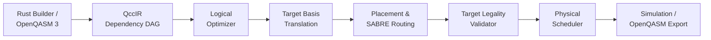

# QCC — Quantum Circuit Compiler

A Rust-first quantum circuit compiler engineered around a DAG-based intermediate representation (**QccIR**), an in-place reference statevector simulator, verified optimization passes, target-aware basis translation, circuit routing, duration/resource scheduling, and OpenQASM 3 interoperability.

---

## Project Status

```text
Status: Phase 59 Complete (Integrated compilation pipeline) — Milestone M6 Complete
Roadmap: 105 Granular Phases (v1.0 Core: Phases 1–89; Advanced Research: Phases 90–105)
Current Active Phase: Phase 60 — Mid-circuit measurement semantics (Not Started)
Completed Phases: 59 / 105
Current Milestone: Milestone M7 — Dynamic Simulation and Non-Unitary Semantics (0 / 8 phases complete)
```

> [!NOTE]
> **Implementation Scope Notice**:
> The project has completed **Phases 1 through 59**, comprising:
> - **Milestone M1**: Bell Vertical Slice (Phases 1–11).
> - **Milestone M2**: Compiler Foundations & QASM (Phases 12–27).
> - **Milestone M3**: Verified Logical Optimizer (Phases 28–36).
> - **Milestone M4**: Generic Target & Basis Translation (Phases 37–43).
> - **Milestone M5**: Logical-to-Physical Mapping & Routing (Phases 44–53).
> - **Milestone M6**: Scheduling & Integrated Compilation (Phases 54–59, Complete).
>
> Phase 60 (Mid-circuit measurement semantics, Milestone M7) is scheduled next.

---

## Prerequisites & Installation

QCC requires a **stable Rust toolchain** (1.80 or newer). Nightly features are strictly prohibited.

To install stable Rust via `rustup`:
```bash
curl --proto '=https' --tlsv1.2 -sSf https://sh.rustup.rs | sh -s -- -y
rustup default stable
rustup component add rustfmt clippy
```

---

## Clean-Checkout Quickstart

After cloning the repository, build, test, and run the CLI version command without manual configuration:

```bash
# 1. Clone repository
git clone https://github.com/000jitendra000/QCC_Quantum_Circuit_Compiler.git
cd QCC_Quantum_Circuit_Compiler

# 2. Build the project
cargo build

# 3. Verify the CLI binary
cargo run -- --version
# Output: qcc 0.1.0

# 4. Run the automated test suite (including golden & proptest property tests)
cargo test

# 5. Run formatting and linting validation
cargo fmt --check
cargo clippy --all-targets -- -D warnings
```

---

## Compilation Pipeline Overview

The default compilation workflow transforms logical quantum circuits into physically executable schedules through strictly verified stages:



---

## Authoritative Specification & Documentation

The engineering specification is derived from `QCC_Quantum_Circuit_Compiler_Engineering_Roadmap(1).docx` (preserved byte-for-byte in [`docs/source/original-roadmap.docx`](./docs/source/original-roadmap.docx)).

### Architectural Knowledge Base
- [**00. Project Charter**](./docs/00-project-charter.md): Product thesis, release horizons (v0.1, v1.0, research), scope boundaries, and non-goals.
- [**01. Architecture Overview**](./docs/01-architecture-overview.md): Subsystems, crate evolution plan, and dependency policy.
- [**02. Formal Semantics & Contracts**](./docs/02-formal-semantics-and-contracts.md): Little-endian qubit indexing ($q_0$ is LSB), column vectors, circuit multiplication order ($B \cdot A$), global phase tracking, wire effects, and QccIR data contracts.
- [**03. Compilation Pipeline**](./docs/03-compilation-pipeline.md): Pipeline ordering rules, pass manager contracts, and verification modes.
- [**04. Correctness & Verification**](./docs/04-correctness-and-verification.md): Unitary equivalence with one common global phase, non-unitary verification modes, numerical tolerances, and differential testing.
- [**05. Target, Routing, & Layout**](./docs/05-target-routing-and-layout.md): Generic target model, injective layouts, baseline router vs SABRE, and ADR-0001.
- [**06. Simulator Design**](./docs/06-simulator-design.md): In-place $\mathcal{O}(2^n)$ amplitude kernels, terminal sampling, stochastic trajectories, and density matrix reference.
- [**07. Milestones & Critical Path**](./docs/07-milestones-and-critical-path.md): Critical path dependencies and plan for the first five coding sessions.
- [**08. Risks & Deferred Scope**](./docs/08-risks-and-deferred-scope.md): Complete risk register, deferred features, and accepted review decisions.
- [**09. Engineering Glossary**](./docs/09-glossary.md): Detailed terminology definitions.

### Implementation Roadmap (105 Phases)
- [**Roadmap Overview**](./docs/roadmap/README.md)
- [**Searchable Phase Index (1–105)**](./docs/roadmap/phase-index.md)
- [Milestone M1: Bell Vertical Slice (Phases 1–11)](./docs/roadmap/phases-001-011.md)
- [Milestone M2: Compiler Foundations & QASM Frontend (Phases 12–27)](./docs/roadmap/phases-012-027.md)
- [Milestone M3: Verified Logical Optimizer (Phases 28–36)](./docs/roadmap/phases-028-036.md)
- [Milestone M4: Generic Target & Basis Translation (Phases 37–43)](./docs/roadmap/phases-037-043.md)
- [Milestone M5: Logical-to-Physical Mapping & Routing (Phases 44–53)](./docs/roadmap/phases-044-053.md)
- [Milestone M6: Scheduling & Integrated Compiler (Phases 54–59)](./docs/roadmap/phases-054-059.md)
- [Milestone M7: Dynamic Simulation & Non-Unitary Semantics (Phases 60–67)](./docs/roadmap/phases-060-067.md)
- [Milestone M8: Differential Validation & Backends (Phases 68–82)](./docs/roadmap/phases-068-082.md)
- [Milestone M9: Developer Experience & Release (Phases 83–89)](./docs/roadmap/phases-083-089.md)
- [Advanced Research Track (Phases 90–105)](./docs/roadmap/phases-090-105.md)

### Project State & Decisions
- [**Implementation Progress Ledger**](./docs/project-state/progress.md): Live checkpoint tracking the completion status and exit gate evidence for all 105 phases.
- [**ADR-0001: Strict Ancilla Zero-State Policy**](./docs/decisions/ADR-0001-ancilla-zero-state-policy.md): Explicit requirement that all unused physical qubits start and finish in $|0\rangle$.

---

## Agent Guidelines & Workflow

AI coding agents and human contributors must consult:
1. [**AGENTS.md**](./AGENTS.md): Core agent rules and instructions.
2. [**Project Invariants Rule**](./.agents/rules/qcc-project-invariants.md): Non-negotiable workspace invariants.
3. [**Phase Execution Workflow**](./.agents/workflows/qcc-phase-execution.md): Step-by-step phase implementation protocol.

---

## Primary Technology Stack

- **Primary Language**: Rust (Stable toolchain)
- **Error Modeling**: `thiserror` (Typed top-level error hierarchy)
- **Property Testing**: `proptest` (Property-based invariant testing)
- **Graph Engine**: `petgraph` (`StableDiGraph` behind typed QccIR abstraction, Milestone M1)
- **Complex Arithmetic**: `num-complex` (`Complex64`, Milestone M1)
- **Random Number Generation**: `rand` (Seeded deterministic RNG, Milestone M1)
- **Text Interchange**: OpenQASM 3.0 supported subset
