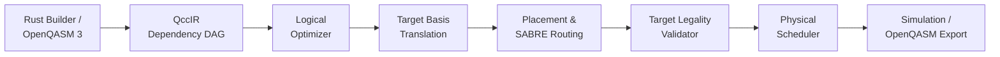

# QCC — Quantum Circuit Compiler

Compiles OpenQASM 3 circuits for a target device: optimizes, translates to
native gates, routes around limited connectivity, and exports verified QASM.

```bash
cargo run -- compile --target linear --stats examples/routing.qasm
```

| | Before | After |
|---|---|---|
| Gates | 6 | 9 |
| Depth | 6 | 9 |
| Router SWAPs inserted | 0 | 1 |

Every optimization pass is checked for unitary equivalence (up to global phase)
by the built-in simulator, and physical outputs can be independently verified
against Qiskit via the independent verification oracle.

---

## Project Status

- **Current Release Baseline**: `v0.1.0` | **Milestones M7–M10 & M12 Accepted**
- **Preserved Historical Baseline (Checkpoint: Phase 59)**: Milestones M1–M6 (Phases 1–59) complete and verified
- **Active Engineering Plan**: **Roadmap v3.1** (Phases 60–85, Milestones M7–M12) — *supersedes the previous 105-phase plan beyond Phase 59*
- **Completed v3.1 Milestones**:
  - **Milestone M7 — Independent Verification Oracle v0.2** (Phases 60–70, Sessions 1–5 complete & accepted)
  - **Milestone M8 — Compiler Introspection and Diagnostics** (Phases 71–73 complete & accepted)
  - **Milestone M9 — Multi-Candidate Routing Improvements** (Phases 74–77 complete & accepted)
  - **Milestone M10 — Evidence-Selected Optimizer Improvements** (Phases 78–81 evaluated & accepted)
  - **Milestone M12 — Integrated Upgrade Acceptance** (Phase 85 complete & accepted)
- **Governance Exclusions**:
  - **Milestone M11 (Phases 82–84, Bounded Hardware Profiles)**: **Explicitly SKIPPED** per project governance decision.

### Preserved Baseline (Phases 1–59)
- **Milestone M1**: Bell Vertical Slice (Phases 1–11)
- **Milestone M2**: Compiler Foundations & OpenQASM 3 Frontend (Phases 12–27)
- **Milestone M3**: Verified Logical Optimizer (Phases 28–36)
- **Milestone M4**: Generic Target & Basis Translation (Phases 37–43)
- **Milestone M5**: Logical-to-Physical Mapping & Routing (Phases 44–53)
- **Milestone M6**: Scheduling & Integrated Compilation (Phases 54–59)

### Active Continuation Milestones (Roadmap v3.1: Phases 60–85)
- **Milestone M7 *(Completed — v0.2 Gate Accepted)***: Independent Verification Oracle (Phases 60–70, executed in 5 sessions; see [`tools/independent_oracle/README.md`](./tools/independent_oracle/README.md) and [M7 Acceptance Report](./docs/project-state/reports/m7-session-5.md))
- **Milestone M8 *(Completed — Diagnostics Gate Accepted)***: Compiler Introspection and Diagnostics (Phases 71–73; see [Phase 73 Report](./docs/project-state/reports/phase-073.md))
- **Milestone M9 *(Completed — Routing Search Gate Accepted)***: Multi-Candidate Routing Improvements (Phases 74–77; see [Phase 77 Report](./docs/project-state/reports/phase-077.md))
- **Milestone M10 *(Completed — Optimizer Gate Accepted)***: Evidence-Selected Optimizer Improvements (Phases 78–81; see [Phase 81 Report](./docs/project-state/reports/phase-081.md))
- **Milestone M11 *(Explicitly Skipped)***: Bounded Hardware Profiles (Phases 82–84; skipped per project governance)
- **Milestone M12 *(Completed — Integrated Acceptance)***: Integrated Upgrade Acceptance and Roadmap Closeout (Phase 85; see [Phase 85 Report](./docs/project-state/reports/phase-085.md))

---

## Independent Verification Oracle v0.2 (Milestone M7)

QCC includes an isolated, CI-enforced Qiskit verification oracle under [`tools/independent_oracle/`](./tools/independent_oracle/README.md) ([`independent-oracle.yml`](./.github/workflows/independent-oracle.yml)). Python and Qiskit are never dependencies of `qcc-core` or normal Rust execution (`cargo test` / `cargo build`).

- **Semantic & Clean-Ancilla Verification**: `1,080 / 1,080` distinct deterministic corpus circuits passed (`836` exhaustive full-$2^m$ unitary comparisons + `244` explicitly labeled non-exhaustive seeded statevector checks; max amplitude error `2.29e-15`; residual ancilla population `0.0`).
- **Fault Sensitivity**: `40 / 40` injected mutations across `17` fault families detected correctly (`0` undetected semantic defects).
- **Fair Matched-Basis Qiskit Baseline (`18` workloads × `5` trials, basis `{rz, sx, cx}`)**:
  - Both compilers achieved **`90 / 90 PASS`** independent semantic verification.
  - **Fairness Disclosures**: `qcc 0.1.0` exposes no randomized CLI search seed and runs `1` deterministic SABRE configuration; `qiskit 2.6.2` (`optimization_level=2`, seeds `1000..1004`) runs **20 internal randomized SABRE layout/swap trials** per call (`equal_internal_compute_budget = false`). Wall-clock timing is informational only (QCC CLI subprocess spawn vs. in-process Qiskit `PassManager.run()`).
  - **Median Results Across All 18 Workloads (QCC vs. Qiskit Win / Tie / Loss)**: CX count **`0 / 5 / 13`**, Circuit depth **`1 / 2 / 15`** (documented optimization/routing gap motivating M9–M10):

| Workload | Target | Width ($n \to m$) | QCC Median (CX / Depth / Gates / Router SWAPs) | Qiskit O2 Best/Med/Worst (CX \| Depth) |
| --- | :---: | :---: | :---: | :---: |
| `03_bell_pair` | `linear` | $2 \to 2$ | `1 / 4 / 4 / 0` | `1/1/1 \| 4/4/4` |
| `04_logical_swap` | `linear` | $2 \to 2$ | `3 / 8 / 12 / 0` | `0/0/0 \| 3/3/3` |
| `05_nontrivial_routing` | `linear` | $3 \to 3$ | `6 / 9 / 9 / 1` | `4/4/6 \| 9/14/14` |
| `07_qft4_showcase_linear` | `linear` | $4 \to 4$ | `27 / 38 / 60 / 3` | `15/15/19 \| 32/34/36` |
| `08_qft4_showcase_ring` | `ring` | $4 \to 4$ | `24 / 36 / 57 / 2` | `14/16/18 \| 27/29/31` |
| `c0037_random_layered_dense_6q_linear` | `linear` | $6 \to 6$ | `60 / 97 / 188 / 13` | `46/48/48 \| 76/81/83` |
| `c0069_random_layered_dense_4q_linear` | `linear` | $4 \to 4$ | `69 / 137 / 232 / 14` | `52/52/56 \| 95/110/110` |

---

## Multi-Candidate Routing Search (Milestone M9)

Milestone M9 introduces opt-in multi-candidate routing search (`--routing-candidates <N>`, `--routing-objective <OBJ>`), exploring diverse placement and routing trajectories while preserving strict target legality and baseline non-regression:

- **Candidate Evaluation & Ranking**: Evaluates candidates under a strict lexicographic comparator: `valid_target > objective_cost > total_swaps > total_depth > candidate_id`.
- **Baseline Provenance & Fallback Guarantee**: Candidate 0 is always generated by the deterministic baseline configuration and marked `is_baseline: true`. Candidate 0 is retained as a fallback; tie-breaking strictly favors lower candidate ID.
- **Benchmark Performance ($B \in \{1, 4, 8, 16\}$, 288 compilations, 96 unique physical circuits)**:
  - **Verification**: `96 / 96 PASS` independent Qiskit oracle verification with 100% ADR-0001 clean-ancilla compliance.
  - **Trajectory Diversification**: On non-trivial topologies (e.g. ring), multi-candidate search explores distinct routing trajectories and reduces SWAP counts.
  - **Default Policy**: Because multi-candidate search increases compilation time roughly linearly with candidate count ($\approx 8.7\times$ at $B=16$), single-candidate routing ($B=1$) remains the universal default. Multi-candidate routing is opt-in for users prioritizing physical circuit quality over compile latency.

---

## Evidence-Selected Optimizer Improvements (Milestone M10)

Milestone M10 introduces the `CommutativeTwoQubitCancellationPass` (`--enable-commutative-cancellation`), addressing the two-qubit gate count deficit identified in the Phase 70 Qiskit baseline:

- **Mathematical Foundations**: Implements forward topological DAG reachability to cancel identical adjacent or commuting two-qubit gates ($CX(c, t) \cdot CX(c, t) = I$, $CZ(a, b) \cdot CZ(b, a) = I$). Commutation checks along control/target wires isolate classical hazards (RAW, WAR, WAW) and non-unitary barriers (`Barrier`, `Measure`, `Reset`).
- **Comparative Benchmark Results (130 circuits × 3 trials, Treatment B vs Control A)**:
  - **Net Physical Reductions**: **538 net physical gates saved** (across 59 improved circuits), **160 net two-qubit gates saved** (63 cancelled logical pairs), **14 router SWAPs saved** (across 10 circuits), and **286 circuit depth reduction**.
  - **Independent Oracle Verification**: **`260 / 260 PASS`** (130/130 Control A + 130/130 Treatment B; max amplitude error $< 10^{-15}$; 100% ADR-0001 clean ancilla zero-state compliance).
- **Mandatory Empirical Qualifications**:
  - *Stage Attribution Unavailable*: For the 378 non-two-qubit eliminated gates: "Observed aggregate reduction; exact stage-level causal attribution unavailable." (160 gates are directly eliminated 2Q gates).
  - *Wall-Clock Timing*: Timing overhead is preliminary and modest (mean pass duration: 0.15 ms; overall runtime multiplier $\approx 1.00\times$).
  - *Routing Interactions*: In 3 dense ring-topology cases, commutative reordering altered the front-layer DAG and slightly increased router SWAPs (+1 to +4 SWAPs).
  - *Release Decision*: In accordance with evidence-based governance, `enable_commutative_cancellation` remains **opt-in** (default `false`) pending future topology-aware thresholding.

---

## Prerequisites & Installation

QCC requires a **stable Rust toolchain** (1.80 or newer). Nightly features are strictly prohibited.

To install stable Rust via `rustup`:
```bash
curl --proto '=https' --tlsv1.2 -sSf https://sh.rustup.rs | sh -s -- -y
rustup default stable
rustup component add rustfmt clippy
```

---

## Clean-Build Quickstart

After cloning the repository, build, test, and run the CLI version command without manual configuration:

```bash
# 1. Clone repository
git clone https://github.com/000jitendra000/QCC_Quantum_Circuit_Compiler.git
cd QCC_Quantum_Circuit_Compiler

# 2. Build the project
cargo build

# 3. Verify the CLI binary
cargo run -- --version
# Output: qcc 0.1.0

# 4. Run the automated test suite (including golden & proptest property tests)
PATH="$PWD/.venv/bin:$PATH" cargo test

# 5. Run formatting and linting validation
cargo fmt --check
cargo clippy --all-targets -- -D warnings

# 6. Compile an OpenQASM 3 file with pass diagnostics
cargo run -- compile examples/routing.qasm --target linear --pass-summary
cargo run -- compile examples/routing.qasm --target linear --pass-report target/diagnostics.json
cargo run -- compile examples/routing.qasm --target linear --inspect-pass inverse_cancellation

# 7. Compile with multi-candidate routing search
cargo run -- compile examples/routing.qasm --target ring --routing-candidates 4 --routing-objective min-swaps

# 8. Compile with evidence-selected commutative two-qubit cancellation
cargo run -- compile examples/commutative_cancellation.qasm --target linear --enable-commutative-cancellation --stats
```

---

## Compiler CLI & Diagnostic Tooling (Milestones M8–M10)

The `qcc compile` subcommand provides comprehensive per-pass diagnostic and introspection tooling conforming to the `qcc.pass_diagnostic` v1.0.0 schema, alongside configurable routing search and optimization flags:

| Option | Argument | Description | Default |
|---|---|---|---|
| `-O, --opt-level` | `<0\|1\|2\|3>` | Optimization aggressiveness level (0 = none, 1 = basic, 2 = standard, 3 = aggressive) | `2` |
| `--target` | `<TARGET>` | Target hardware topology (`linear`, `ring`, `linear-generic`, `ring-generic`) | `None` (frontend only) |
| `--pass-report` | `<FILE>` | Export `qcc.pass_diagnostic` JSON report array to `<FILE>` | `None` |
| `--inspect-pass` | `<ID>` | Print comprehensive human-readable diagnostic report for pass `<ID>` to `stderr` | `None` |
| `--pass-summary` | *(none)* | Print concise ASCII table of pass order, status, duration, deltas, and verification to `stderr` | `false` |
| `--pass-diagnostics` | `<MODE>` | Diagnostic mode preset: `'basic'`, `'metrics'`, `'fingerprints'`, `'standard'`, `'full'` | `'basic'` when diagnostics requested |
| `--pass-metrics` | *(none)* | Collect before/after circuit snapshot metrics | `false` |
| `--pass-fingerprints` | *(none)* | Compute SHA-256 circuit representation fingerprints | `false` |
| `--pass-verify` | *(none)* | Run in-tree unitary equivalence verification hooks | `false` |
| `--emit-manifest` | `<FILE>` | Write machine-readable `qcc.compile_manifest` JSON manifest | `None` |
| `--routing-candidates` | `<N>` | Number of routing candidates to explore (opt-in multi-candidate search; requires `--target`) | `1` |
| `--routing-objective` | `<OBJ>` | Candidate evaluation objective: `'min-swaps'` (default), `'min-depth'`, `'min-cx'`, `'min-gates'` | `'min-swaps'` |
| `--enable-commutative-cancellation` | *(none)* | Enable commutative two-qubit ($CX/CZ$) cancellation pass (opt-in) | `false` |
| `--stats` | *(none)* | Print compilation statistics (gates, depth, SWAPs) to `stderr` | `false` |

---

## Compilation Pipeline Overview

The compilation workflow transforms logical quantum circuits into physically executable schedules through strictly verified stages:



---

## Authoritative Specification & Documentation

Active engineering direction follows **Roadmap v3.1** (`QCC_Quantum_Circuit_Compiler_Engineering_Roadmap_v3.1.docx`, 12 November 2026) for **Phases 60–85 (Milestones M7–M12)**. Phases 1–59 (Milestones M1–M6) were completed against `QCC_Quantum_Circuit_Compiler_Engineering_Roadmap(1).docx` (preserved in [`docs/source/original-roadmap.docx`](./docs/source/original-roadmap.docx), superseded beyond Phase 59 by Roadmap v3.1).

### Architectural Knowledge Base
- [**00. Project Charter**](./docs/00-project-charter.md): Product thesis, Phase 59 checkpoint, v3.1 release horizons, scope boundaries, and deferred tracks.
- [**01. Architecture Overview**](./docs/01-architecture-overview.md): Subsystems, `tools/independent_oracle/` layout, and dependency policy.
- [**02. Formal Semantics & Contracts**](./docs/02-formal-semantics-and-contracts.md): Little-endian qubit indexing ($q_0$ is LSB), column vectors, circuit multiplication order ($B \cdot A$), global phase tracking, wire effects, and QccIR data contracts.
- [**03. Compilation Pipeline**](./docs/03-compilation-pipeline.md): Pipeline ordering rules, pass manager contracts, and verification modes.
- [**04. Correctness & Verification**](./docs/04-correctness-and-verification.md): Unitary equivalence with one common global phase, numerical tolerances, and the M7 independent Qiskit oracle policy.
- [**05. Target, Routing, & Layout**](./docs/05-target-routing-and-layout.md): Generic target model, injective layouts, baseline router vs SABRE, and ADR-0001.
- [**06. Simulator Design**](./docs/06-simulator-design.md): In-place $\mathcal{O}(2^n)$ amplitude kernels, terminal sampling, and deferred dynamic/density specifications.
- [**07. Milestones & Critical Path**](./docs/07-milestones-and-critical-path.md): Active v3.1 critical path, Milestones M1–M12, and the M7 five-session plan.
- [**08. Risks & Deferred Scope**](./docs/08-risks-and-deferred-scope.md): Risk register, deferred features, and accepted v3.1 continuation decisions.
- [**09. Engineering Glossary**](./docs/09-glossary.md): Detailed terminology definitions.

### Compiler Milestone Roadmap

- [**Roadmap Overview**](./docs/roadmap/README.md)
- [**Phase Index (Phases 1–85)**](./docs/roadmap/phase-index.md)
- **Preserved Historical Baseline (Phases 1–59 / Checkpoint: Phase 59)**:
  - [Milestone M1: Bell Vertical Slice (Phases 1–11)](./docs/roadmap/phases-001-011.md)
  - [Milestone M2: Compiler Foundations & QASM Frontend (Phases 12–27)](./docs/roadmap/phases-012-027.md)
  - [Milestone M3: Verified Logical Optimizer (Phases 28–36)](./docs/roadmap/phases-028-036.md)
  - [Milestone M4: Generic Target & Basis Translation (Phases 37–43)](./docs/roadmap/phases-037-043.md)
  - [Milestone M5: Logical-to-Physical Mapping & Routing (Phases 44–53)](./docs/roadmap/phases-044-053.md)
  - [Milestone M6: Scheduling & Integrated Compiler (Phases 54–59)](./docs/roadmap/phases-054-059.md)
- **Active Continuation (Roadmap v3.1 — Phases 60–85 / Milestones M7–M12)**:
  - [Milestones M7–M12 & M7 Five-Session Plan (Phases 60–85)](./docs/roadmap/phases-060-085.md)

### Project State & Decisions
- [**Implementation Progress Ledger**](./docs/project-state/progress.md): Milestones M1–M10 & M12 completed; M11 skipped.
- [**ADR-0001: Strict Ancilla Zero-State Policy**](./docs/decisions/ADR-0001-ancilla-zero-state-policy.md): Explicit requirement that all unused physical qubits start and finish in $|0\rangle$.
- [**ADR-0003: Independent Oracle & Manifest Contract**](./docs/decisions/ADR-0003-independent-oracle-and-manifest-contract.md): Oracle isolation, domain boundary, and `qcc.compile_manifest` (`1.0.0`).
- [**ADR-0004: QASM3 Importer Register Collision Adapter**](./docs/decisions/ADR-0004-qasm3-importer-register-collision-fallback.md): Semantics-preserving AST register alpha-renaming for `qiskit-qasm3-import`.
- [**ADR-0005: Evidence-Selected Optimizer Priority**](./docs/decisions/ADR-0005-evidence-selected-optimizer-priority.md): Commutative two-qubit cancellation prioritization and proof obligations.

---

## Verification Scope & Limitations (Anti-Overclaim Boundaries)

1. **Finite Verification vs. Formal Proof**: The built-in unitary simulator and independent Qiskit verification oracle validate finite test suites and sampled states up to numerical tolerances ($< 10^{-14}$). These tests provide high confidence in compiler behavior across evaluated workloads, but do not constitute formal machine-checked correctness proofs for infinite circuit classes.
2. **Empirical Benchmarks vs. Global Optimality**: Routing and optimization algorithms are heuristic. While multi-candidate search and commutative cancellation demonstrate empirical improvements on tested corpora, QCC makes no claim of global optimality across arbitrary quantum circuits.
3. **Hardware Modeling & Unknown Quantities**: Calibration data, gate fidelities, and execution durations not specified in target models are treated as unknown (`None`), never assumed to be zero.
4. **Explicitly Deferred Features**:
   - Noise simulation and density-matrix state representations.
   - Dynamic control-flow execution (mid-circuit measurement collapse and quantum trajectories).
   - KAK decomposition and matrix product state (MPS) simulation.
   - Remote quantum cloud provider adapters and execution services.

---

## Agent Guidelines & Workflow

AI coding agents and human contributors must consult:
1. [**AGENTS.md**](./AGENTS.md): Core agent rules, M7 implementation decisions, and roadmap anti-drift governance.
2. [**Project Invariants Rule**](./.agents/rules/qcc-project-invariants.md): Non-negotiable workspace invariants.
3. [**Phase & Session Execution Workflow**](./.agents/workflows/qcc-phase-execution.md): Step-by-step execution protocol.

---

## Primary Technology Stack

- **Primary Language**: Rust (Stable toolchain)
- **Error Modeling**: `thiserror` (Typed top-level error hierarchy)
- **Property Testing**: `proptest` (Property-based invariant testing)
- **Graph Engine**: `petgraph` (`StableDiGraph` behind typed QccIR abstraction, Milestone M1)
- **Complex Arithmetic**: `num-complex` (`Complex64`, Milestone M1)
- **Random Number Generation**: `rand` (Seeded deterministic RNG, Milestone M1)
- **Text Interchange**: OpenQASM 3.0 supported subset
