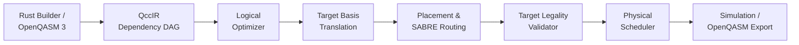

# QCC — Quantum Circuit Compiler

Compiles OpenQASM 3 circuits for a target device: optimizes, translates to
native gates, routes around limited connectivity, and exports verified QASM.

```bash
cargo run -- compile --target linear --stats examples/routing.qasm
```

| | Before | After |
|---|---|---|
| Gates | 6 | 9 |
| Depth | 6 | 9 |
| Router SWAPs inserted | 0 | 1 |

Every optimization pass is checked for unitary equivalence (up to global phase)
by the built-in simulator.

---

## Project Status

- **Current Release**: [v0.1.0](https://github.com/000jitendra000/QCC_Quantum_Circuit_Compiler/commits/v0.1.0) ([Commit History](https://github.com/000jitendra000/QCC_Quantum_Circuit_Compiler/commits/v0.1.0))
- **Preserved Historical Baseline (Checkpoint: Phase 59)**: Milestones M1–M6 (Phases 1–59) complete and verified
- **Active Engineering Plan**: **Roadmap v3.1** (Phases 60–85, Milestones M7–M12) — *supersedes the previous 105-phase plan beyond Phase 59*
- **Active Next Work**: **M7 — Independent Verification Oracle v0.2 (Session 1: Contract and manifest-first Rust work)**

### Preserved Baseline (Phases 1–59)
- **Milestone M1**: Bell Vertical Slice (Phases 1–11)
- **Milestone M2**: Compiler Foundations & OpenQASM 3 Frontend (Phases 12–27)
- **Milestone M3**: Verified Logical Optimizer (Phases 28–36)
- **Milestone M4**: Generic Target & Basis Translation (Phases 37–43)
- **Milestone M5**: Logical-to-Physical Mapping & Routing (Phases 44–53)
- **Milestone M6**: Scheduling & Integrated Compilation (Phases 54–59)

### Active Continuation & Planned Milestones (Roadmap v3.1: Phases 60–85)
- **Milestone M7 *(Active Next — v0.2 Gate)***: Independent Verification Oracle (Phases 60–70, executed in 5 sessions starting at **Session 1**)
- **Milestone M8**: Compiler Introspection and Diagnostics (Phases 71–73)
- **Milestone M9**: Multi-Candidate Routing Improvements (Phases 74–77)
- **Milestone M10**: Evidence-Selected Optimizer Improvements (Phases 78–81)
- **Optional Milestone M11**: Bounded Hardware Profiles (Phases 82–84; optional post-M10 go/no-go review)
- **Milestone M12**: Integrated Upgrade Acceptance (Phase 85)

> [!NOTE]
> Noise simulation, density-matrix simulation, dynamic CFG execution, KAK, MPS, and remote provider adapters remain deferred outside Phases 60–85. Qiskit/Python oracle tooling will reside strictly in `tools/independent_oracle/` for dev/CI and never as a `qcc-core` dependency.

---

## Prerequisites & Installation

QCC requires a **stable Rust toolchain** (1.80 or newer). Nightly features are strictly prohibited.

To install stable Rust via `rustup`:
```bash
curl --proto '=https' --tlsv1.2 -sSf https://sh.rustup.rs | sh -s -- -y
rustup default stable
rustup component add rustfmt clippy
```

---

## Clean-Checkout Quickstart

After cloning the repository, build, test, and run the CLI version command without manual configuration:

```bash
# 1. Clone repository
git clone https://github.com/000jitendra000/QCC_Quantum_Circuit_Compiler.git
cd QCC_Quantum_Circuit_Compiler

# 2. Build the project
cargo build

# 3. Verify the CLI binary
cargo run -- --version
# Output: qcc 0.1.0

# 4. Run the automated test suite (including golden & proptest property tests)
cargo test

# 5. Run formatting and linting validation
cargo fmt --check
cargo clippy --all-targets -- -D warnings
```

---

## Compilation Pipeline Overview

The default compilation workflow transforms logical quantum circuits into physically executable schedules through strictly verified stages:



---

## Authoritative Specification & Documentation

Active engineering direction follows **Roadmap v3.1** (`QCC_Quantum_Circuit_Compiler_Engineering_Roadmap_v3.1.docx`, 12 November 2026) for **Phases 60–85 (Milestones M7–M12)**. Phases 1–59 (Milestones M1–M6) were completed against `QCC_Quantum_Circuit_Compiler_Engineering_Roadmap(1).docx` (preserved in [`docs/source/original-roadmap.docx`](./docs/source/original-roadmap.docx), superseded beyond Phase 59 by Roadmap v3.1).

### Architectural Knowledge Base
- [**00. Project Charter**](./docs/00-project-charter.md): Product thesis, Phase 59 checkpoint, v3.1 release horizons, scope boundaries, and deferred tracks.
- [**01. Architecture Overview**](./docs/01-architecture-overview.md): Subsystems, `tools/independent_oracle/` layout, and dependency policy.
- [**02. Formal Semantics & Contracts**](./docs/02-formal-semantics-and-contracts.md): Little-endian qubit indexing ($q_0$ is LSB), column vectors, circuit multiplication order ($B \cdot A$), global phase tracking, wire effects, and QccIR data contracts.
- [**03. Compilation Pipeline**](./docs/03-compilation-pipeline.md): Pipeline ordering rules, pass manager contracts, and verification modes.
- [**04. Correctness & Verification**](./docs/04-correctness-and-verification.md): Unitary equivalence with one common global phase, numerical tolerances, and the M7 independent Qiskit oracle policy.
- [**05. Target, Routing, & Layout**](./docs/05-target-routing-and-layout.md): Generic target model, injective layouts, baseline router vs SABRE, and ADR-0001.
- [**06. Simulator Design**](./docs/06-simulator-design.md): In-place $\mathcal{O}(2^n)$ amplitude kernels, terminal sampling, and deferred dynamic/density specifications.
- [**07. Milestones & Critical Path**](./docs/07-milestones-and-critical-path.md): Active v3.1 critical path, Milestones M1–M12, and the M7 five-session plan.
- [**08. Risks & Deferred Scope**](./docs/08-risks-and-deferred-scope.md): Risk register, deferred features, and accepted v3.1 continuation decisions.
- [**09. Engineering Glossary**](./docs/09-glossary.md): Detailed terminology definitions.

### Compiler Milestone Roadmap

- [**Roadmap Overview**](./docs/roadmap/README.md)
- [**Phase Index (Phases 1–85)**](./docs/roadmap/phase-index.md)
- **Preserved Historical Baseline (Phases 1–59 / Checkpoint: Phase 59)**:
  - [Milestone M1: Bell Vertical Slice (Phases 1–11)](./docs/roadmap/phases-001-011.md)
  - [Milestone M2: Compiler Foundations & QASM Frontend (Phases 12–27)](./docs/roadmap/phases-012-027.md)
  - [Milestone M3: Verified Logical Optimizer (Phases 28–36)](./docs/roadmap/phases-028-036.md)
  - [Milestone M4: Generic Target & Basis Translation (Phases 37–43)](./docs/roadmap/phases-037-043.md)
  - [Milestone M5: Logical-to-Physical Mapping & Routing (Phases 44–53)](./docs/roadmap/phases-044-053.md)
  - [Milestone M6: Scheduling & Integrated Compiler (Phases 54–59)](./docs/roadmap/phases-054-059.md)
- **Active Continuation (Roadmap v3.1 — Phases 60–85 / Milestones M7–M12)**:
  - [Milestones M7–M12 & M7 Five-Session Plan (Phases 60–85)](./docs/roadmap/phases-060-085.md)

### Project State & Decisions
- [**Implementation Progress Ledger**](./docs/project-state/progress.md): Phase 59 completion evidence and v3.1 tracking ledger (next: **M7 Session 1**).
- [**ADR-0001: Strict Ancilla Zero-State Policy**](./docs/decisions/ADR-0001-ancilla-zero-state-policy.md): Explicit requirement that all unused physical qubits start and finish in $|0\rangle$.

---

## Agent Guidelines & Workflow

AI coding agents and human contributors must consult:
1. [**AGENTS.md**](./AGENTS.md): Core agent rules, M7 implementation decisions, and roadmap anti-drift governance.
2. [**Project Invariants Rule**](./.agents/rules/qcc-project-invariants.md): Non-negotiable workspace invariants.
3. [**Phase & Session Execution Workflow**](./.agents/workflows/qcc-phase-execution.md): Step-by-step execution protocol (starting at **M7 Session 1**).

---

## Primary Technology Stack

- **Primary Language**: Rust (Stable toolchain)
- **Error Modeling**: `thiserror` (Typed top-level error hierarchy)
- **Property Testing**: `proptest` (Property-based invariant testing)
- **Graph Engine**: `petgraph` (`StableDiGraph` behind typed QccIR abstraction, Milestone M1)
- **Complex Arithmetic**: `num-complex` (`Complex64`, Milestone M1)
- **Random Number Generation**: `rand` (Seeded deterministic RNG, Milestone M1)
- **Text Interchange**: OpenQASM 3.0 supported subset
