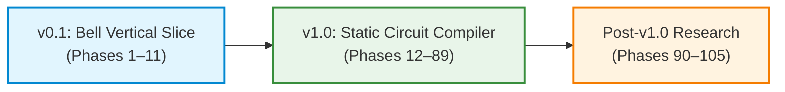

# QCC Project Charter

## 1. Project Thesis

**QCC (Quantum Circuit Compiler)** is a Rust-first quantum circuit compiler engineered around:
- A dependency DAG-based intermediate representation (**QccIR**).
- An in-place reference statevector simulator operating on double-precision complex numbers (`Complex64`).
- Semantics-preserving, verified logical optimization passes.
- Target-aware basis translation.
- Logical-to-physical qubit mapping and circuit routing.
- Duration- and resource-constrained scheduling.
- OpenQASM 3 interoperability (input parsing and output emission).
- Explainable compilation reports and execution inspection.

QCC is both a high-rigor compiler-engineering initiative and a quantum-computing foundations project. We do not invent a bespoke quantum programming language; rather, we build a robust compiler that ingests quantum circuits, transforms them under target constraints, and preserves quantum semantics with mathematical provability.

---

## 2. Core Architectural Philosophy

1. **Rust-First & Stable Toolchain**: Written entirely in idiomatic, stable Rust. No nightly features, no unstable compiler flags, no unverified unsafe blocks.
2. **Semantics Before Optimization**: A compiler transformation is useless if it alters quantum state amplitudes. Equivalence checking up to a common global phase must exist before any optimization pass is written.
3. **Builder Before Parser**: Core compiler data structures and execution engines are developed and validated using a native Rust builder API before exposing a textual parser frontend.
4. **DAG Per Basic Block**: Operation ordering is governed by explicit quantum and classical wire dependencies in a directed acyclic graph, not by a fragile linear array of instructions.
5. **Fail-Closed Target Legality**: Circuits targeting physical hardware must strictly adhere to native gate sets, coupling topologies, and operand orientations. Illegal gates cannot silently slip into emission.
6. **Explicit Unknowns**: If hardware calibration or timing metrics are absent, they are explicitly modeled as `Unknown`, never assumed to be zero.

---

## 3. Product Release Horizons

### 3.1 v0.1 Deliverable — Bell Vertical Slice (Phases 1–11)
- Minimal, fully functional end-to-end vertical slice.
- Circuit construction via Rust `CircuitBuilder` API.
- QccIR representation modeling quantum registers, classical registers, unitary gates, measurement, and classical dependencies.
- In-place statevector simulation of $H(q_0)$ followed by $CX(q_0, q_1)$, yielding amplitudes $[\frac{1}{\sqrt{2}}, 0, 0, \frac{1}{\sqrt{2}}]$ in little-endian ordering.
- Terminal measurement sampling from calculated probabilities with deterministic seeded RNG.
- Emission of valid OpenQASM 3 source code (`OPENQASM 3.0;`, `include "stdgates.inc";`).
- Independent verification using an external parser.
- Verification oracle: global-phase-aware unitary equivalence checker.

### 3.2 v1.0 Deliverable — Static Circuit Compiler (Phases 12–89)
- Robust OpenQASM 3 subset parsing, semantic analysis, and AST-to-QccIR lowering.
- Deterministic pass manager and transactional DAG rewrite infrastructure.
- Verified logical optimization: identity elimination, inverse cancellation, rotation merge, Euler decomposition, one-qubit fusion, and DAG-aware commutation.
- Target hardware description: qubit capacity, native operations, coupling graphs, and operand directionality.
- Recursive basis translation into target-native instruction sets.
- Logical-to-physical qubit mapping: heuristic placement and full bidirectional SABRE routing.
- ASAP/ALAP and resource-constrained scheduling on routed physical circuits.
- Dynamic simulation: mid-circuit measurement collapse, stochastic trajectories, bounded exact branch enumeration, and non-unitary reset.
- Differential verification harness: cross-validation against Qiskit Aer, Cirq, and Stim.
- Developer experience: full CLI (`compile`, `simulate`, `optimize`, `route`, `verify`, `inspect`), ASCII/SVG visualization, compilation reports, and reproducibility manifests.

### 3.3 Advanced Research Track (Phases 90–105)
- Calibration-aware multi-objective cost models.
- User-defined composite gate AST, scoping, and expansion.
- Control-Flow Graph (CFG) layer above basic-block DAGs with typed classical conditions and bounded loops.
- Arbitrary two-qubit unitary synthesis using the KAK decomposition ($SU(4) \cong SU(2) \otimes SU(2) \times A$).
- Matrix Product States (MPS) tensor-network simulation for weakly entangled circuits.
- Advanced optimization research (ZX calculus, Clifford+T, equality saturation).

---

## 4. Explicit Scope Boundaries and Non-Goals

To maintain strict engineering focus, the following items are explicitly **out of scope** for v0.x and v1.0:

1. **No Bespoke DSL**: QCC will not introduce a custom `.qcc` programming language. OpenQASM 3 is the standard textual interchange format.
2. **QccIR is Not Microsoft QIR**: QccIR is an in-memory dependency DAG implemented in Rust. Microsoft QIR is an LLVM-based bitcode representation. Interoperability with QIR is strictly an export target (Phase 81).
3. **No Unbounded Dynamic Programs in v1.0**: General loops and conditionals require the post-v1.0 CFG layer. v1.0 handles static quantum circuits with terminal or bounded mid-circuit measurements.
4. **No Pulse-Level Control**: QCC targets gate-level quantum compilation. OpenPulse / Qiskit Pulse scheduling is deferred.
5. **No Quantum Error Correction (QEC)**: Logical-to-physical QEC architectures (surface codes, lattice surgery) are separate disciplines.
6. **No GPU or Distributed Simulator**: The primary simulator is an in-place CPU statevector engine optimized for exactness and transparency.
7. **No Unsupported Hardware Execution Claims**: Passing "topology validity" means satisfying graph connectivity and gate directions; it does not guarantee execution fidelity on physical quantum hardware without live calibration and credentials.

