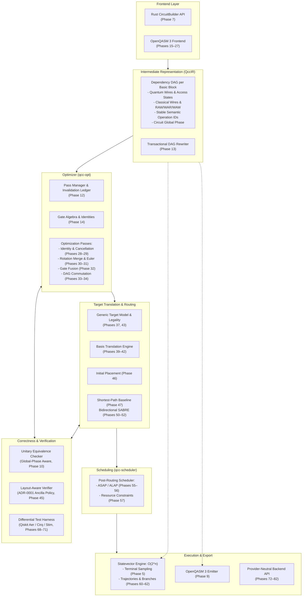

# QCC Architecture Overview

## 1. System Architecture Diagram

The high-level architecture of the Quantum Circuit Compiler is partitioned into decoupled subsystems communicating through strictly versioned contracts:



---

## 2. Workspace Evolution Plan

To avoid premature abstraction and build friction while stabilizing core APIs, the codebase follows a two-stage packaging strategy:

### Stage 1: Single Consolidated Package (Milestones M1–M2)
Initial implementation begins as a single Cargo package with well-defined internal modules:
```text
qcc/
├── Cargo.toml
├── Cargo.lock
├── README.md
├── src/
│   ├── lib.rs
│   ├── main.rs
│   ├── errors.rs
│   ├── diagnostics/
│   ├── quantum/
│   ├── simulator/
│   ├── ir/
│   ├── builder/
│   ├── backend/
│   └── verification/
├── examples/
│   └── bell.rs
├── tests/
│   ├── smoke.rs
│   └── quantum_semantics.rs
└── docs/
```

### Stage 2: Multi-Crate Workspace (Milestones M3+)
Once public interfaces and data contracts are stabilized through exit gates, the package is partitioned into focused, independently testable crates:

| Crate | Responsibility |
|---|---|
| `qcc-core` | Fundamental quantum semantics, gates, registers, parameters, angle algebra. |
| `qcc-ir` | QccIR dependency DAG, nodes, edges, wire access state, transactional rewrites. |
| `qcc-frontend-qasm3` | OpenQASM 3 lexer, parser, AST, semantic checks, and lowering. |
| `qcc-opt` | Pass manager, algebraic identities, optimization passes, commutation rules. |
| `qcc-target` | Target machine descriptions, capability queries, cost models, basis translation. |
| `qcc-routing` | Layout mappings, initial placement heuristics, baseline router, SABRE router. |
| `qcc-scheduler` | Timing models, resource calendars, ASAP/ALAP, resource-constrained scheduling. |
| `qcc-sim-statevector`| In-place statevector simulation kernels, terminal sampling, dynamic trajectories. |
| `qcc-sim-density` | Density matrix reference engine, partial trace, Kraus noise channels. |
| `qcc-backend-api` | Provider-neutral submission, job lifecycle, credential handling, results. |
| `qcc-backend-openqasm`| OpenQASM 3 emission and execution artifact bundling. |
| `qcc-testkit` | Random circuit generators, property-test strategies, differential test harnesses. |
| `qcc-cli` | Command-line interface, inspection commands, ASCII/SVG visualization. |

---

## 3. Dependency Policy

Every dependency introduced into QCC must serve a specific architectural purpose and must strictly avoid polluting core types:

| Dependency | Purpose | Architectural Decision |
|---|---|---|
| `petgraph` | Low-level directed graph data structures. | Use `StableDiGraph` internally. **Never expose raw petgraph `NodeIndex` or `EdgeIndex` outside QccIR**. Maintain QCC-owned stable `OperationId`s and deterministic topological sorting. |
| `num-complex` | Complex numbers (`Complex64`). | Standard representation for statevector amplitudes and unitary matrix elements. |
| `rand` | Seeded pseudo-random number generation. | Required for terminal measurement sampling and property testing. All simulation must accept an explicit seed for 100% deterministic reproducibility. |
| `thiserror` | Structured error derive macros. | Used across crates for domain-specific, typed error enums with clear diagnostic messages. |
| `serde` | Data serialization / deserialization. | Used for machine-readable manifests, target profiles, and schedule outputs. Not used as a replacement for semantic IR types. |
| `proptest` | Property-based testing framework. | Adopted from Phase 10 onwards for generating random unitary circuits, layout permutations, and statevectors. |
| `clap` | Command-line argument parsing. | Used for CLI command-line parsing. |
| `criterion` | Statistical benchmarking framework. | Introduced for performance regressions in simulator kernels, DAG rewrites, and router passes. |
| `rug` / `double-double` | High-precision arithmetic. | **Optional only**. Used exclusively if analytical reference proofs demonstrate $f64$ numerical instability. |
| `oq3_*` | OpenQASM 3 parsing crates. | Evaluated behind an adapter in Phase 15. If experimental crate stability fails, fall back to a handwritten parser for the supported subset. |
| External Simulators (Qiskit, Cirq, Stim) | Differential validation oracles. | **Strictly external reference tools**. Invoked via CLI or Python bridges in `tests/differential/`. Never hard dependencies of `qcc-core`. |
| `mqt-qmap` | Router benchmark reference. | External reference oracle only, not a Rust dependency. |

