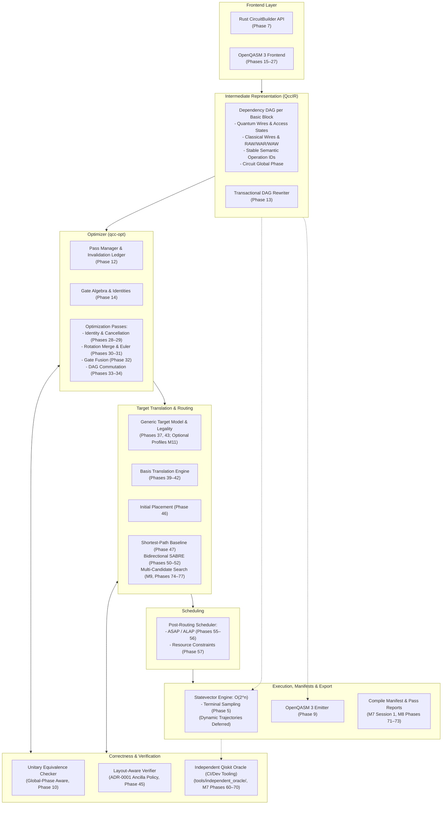

# QCC Architecture Overview

## 1. System Architecture Diagram

The high-level architecture of the Quantum Circuit Compiler is partitioned into decoupled subsystems communicating through strictly versioned contracts:



---

## 2. Workspace Structure (Phase 59 Baseline + v3.1 Tooling Plan)

QCC keeps the established single-crate Rust package boundaries already implemented through Phase 59, adding the independent Qiskit verification oracle strictly as repository tooling under `tools/independent_oracle/` (never as a `qcc-core` or runtime dependency):

```text
qcc/
├── Cargo.toml
├── Cargo.lock
├── README.md
├── src/
│   ├── lib.rs
│   ├── main.rs
│   ├── errors.rs
│   ├── diagnostics/
│   ├── quantum/
│   ├── simulator/
│   ├── ir/
│   ├── builder/
│   ├── frontend/
│   ├── optimizer/
│   ├── decomposition/
│   ├── commutation/
│   ├── target/
│   ├── synthesis/
│   ├── translation/
│   ├── routing/
│   ├── scheduler/
│   ├── compiler/
│   ├── cli/
│   ├── backend/
│   └── verification/
├── tools/
│   └── independent_oracle/       # M7 (Phases 60–70): Optional Python/Qiskit dev & CI tooling
│       ├── generators/
│       ├── references/
│       ├── runners/
│       ├── equivalence/
│       ├── corpus/
│       └── reports/
├── examples/
├── tests/
└── docs/
```

> [!NOTE]
> The earlier multi-crate split (`qcc-sim-density`, `qcc-backend-api`, etc.) from the superseded 105-phase roadmap is not pursued under Roadmap v3.1. Dynamic trajectories, density-matrix simulation, and remote provider backends remain deferred outside Phases 60–85.

---

## 3. Dependency Policy

Every dependency introduced into QCC must serve a specific architectural purpose and must strictly avoid polluting core types:

| Dependency | Purpose | Architectural Decision |
|---|---|---|
| `petgraph` | Low-level directed graph data structures. | Use `StableDiGraph` internally. **Never expose raw petgraph `NodeIndex` or `EdgeIndex` outside QccIR**. Maintain QCC-owned stable `OperationId`s and deterministic topological sorting. |
| `num-complex` | Complex numbers (`Complex64`). | Standard representation for statevector amplitudes and unitary matrix elements. |
| `rand` | Seeded pseudo-random number generation. | Required for terminal measurement sampling and property testing. All simulation must accept an explicit seed for 100% deterministic reproducibility. |
| `thiserror` | Structured error derive macros. | Used across compiler modules for domain-specific, typed error enums with clear diagnostic messages. |
| `serde` / `serde_json` | Data serialization / deserialization. | Used for versioned compile manifests (M7 Session 1), pass reports (M8), target profiles, and schedule outputs. Not used as a replacement for semantic IR types. |
| `proptest` | Property-based testing framework. | Adopted from Phase 1 onwards for generating random unitary circuits, layout permutations, and statevectors. |
| `clap` | Command-line argument parsing. | Optional CLI parsing aid when/if adopted for CLI expansion. |
| `criterion` | Statistical benchmarking framework. | Optional benchmarking harness when performance benchmarks are introduced. |
| `rug` / `double-double` | High-precision arithmetic. | **Optional only**. Used exclusively if $f64$ error analysis demonstrates a need; no stable `f128` requirement. |
| `oq3_*` | OpenQASM 3 parsing crates. | Evaluated behind an adapter in Phase 15 (ADR-0002 selected the in-tree handwritten subset parser). |
| **Qiskit SDK / `qiskit-qasm3-import`** | Independent unitary verification & baseline comparison (M7, Phases 60–70). | **Strictly optional dev/CI tooling in `tools/independent_oracle/`**. Pin exact versions and record them with artifacts; **never** a dependency of `qcc-core` or normal Rust execution. |
| `Qiskit Aer` / `Cirq` / `Stim` / `mqt-qmap` | Additional differential/routing references. | Strictly optional external reference tools, never core Rust dependencies. |

