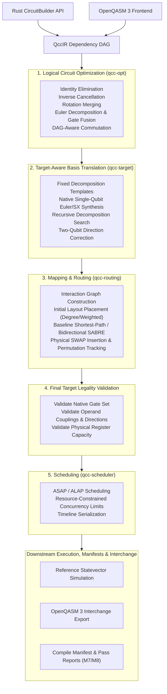

# QCC Default Compilation Pipeline

## 1. End-to-End Pipeline Stages

The QCC compilation workflow follows a strictly ordered, multi-stage architecture designed to enforce semantic correctness, hardware legality, and modular testability at every boundary:

---

## 2. Non-Negotiable Ordering Rules

The sequence of compiler stages is mathematically grounded and must not be casually reordered:

1. **Rust Builder Precedes OpenQASM Parser**: The circuit engine, QccIR data structures, and simulator must be operational and verified before building a textual grammar parser.
2. **Bell Vertical Slice Precedes General Features**: Milestone M1 (the Bell vertical slice) proves the foundational pipeline before expanding into broader frontend or optimizer features.
3. **Equivalence Checking Precedes Optimizer Development**: The global-phase-aware unitary equivalence checker (Phase 10) is the correctness oracle; writing optimizer passes without an automated correctness oracle invites silent semantic corruption.
4. **Transactional DAG Rewriting Precedes Graph-Changing Passes**: Phase 13 centralizes node insertion, removal, replacement, and wire reconnection with automatic invariant checks. Passes never mutate petgraph nodes directly.
5. **Target Translation Precedes Routing**: The circuit must be decomposed into entangling gates supported by the target (e.g., $CX$ or $CZ$) before the router attempts to place and route them along physical coupling edges.
6. **Scheduling Follows Routing**: Scheduling requires concrete physical gate durations and physical resource assignments. Because routing inserts physical $SWAP$ gates and updates layouts, scheduling must operate exclusively on the **final routed physical DAG**.

---

## 3. Pass Manager Contract

Every optimization, translation, and analysis pass implements the `CompilerPass` trait and explicitly declares its preconditions, invalidation behavior, and semantic guarantees:

| Contract Field | Specification Requirement |
|---|---|
| **Input Preconditions** | Required QccIR version, acyclicity, well-typed registers, and semantic domain (e.g., unitary-only vs measurement-aware). |
| **Analyses Required** | Analyses that must be computed prior to pass execution (e.g., topological order, wire adjacency, interaction graph, layout). |
| **Mutation Scope** | Explicit declaration of which graph elements may be altered: nodes, edges, registers, parameters, or metadata. |
| **Preserved Analyses** | Analyses guaranteed to remain valid after pass completion. |
| **Invalidated Analyses** | Cached analyses that are invalidated and must be lazily or eagerly recomputed. |
| **Postconditions** | Enforceable invariants guaranteed upon completion (e.g., target operation legality, acyclicity, valid wire dependencies). |
| **Verification Mode** | Required automated test verification: unitary equivalence, layout-aware equivalence, non-unitary channel equivalence, or target legality. |
| **Metrics & Telemetry** | Mandatory metrics reported: gates added/removed, depth delta, global phase delta, and execution duration. |

### 3.1 Debug Verification Mode
In debug builds or when `--verify-each` is enabled, the pass manager automatically invokes the appropriate equivalence checker and graph validator after **every individual pass**. If any pass alters circuit unitary action or corrupts wire dependencies, compilation aborts immediately with a pinpoint diagnostic.

