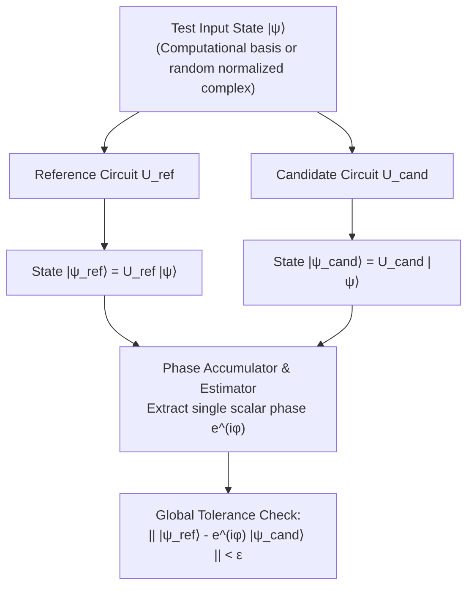

# QCC Correctness and Verification Strategy

## 1. Unitary Equivalence Verification

The global-phase-aware unitary equivalence checker (Phase 10) serves as the primary correctness oracle for all logical transformations, syntheses, and optimizations in QCC.

### 1.1 Mathematical Formulation
Two circuits representing operations $U_A$ and $U_B$ on $n$ qubits are unitarily equivalent if and only if there exists a **single common global phase** $\phi \in [0, 2\pi)$ such that:
$$U_A = e^{i \phi} U_B$$

For any input state $|\psi\rangle$, the output states $|\psi_A\rangle = U_A |\psi\rangle$ and $|\psi_B\rangle = U_B |\psi\rangle$ must satisfy:
$$|\psi_A\rangle = e^{i \phi} |\psi_B\rangle$$

### 1.2 Multi-Tiered Verification Protocol
1. **Exhaustive Basis Testing ($n \le 3$)**: For small qubit counts, the verifier injects all $2^n$ computational basis states $|e_k\rangle$. This reconstructs the entire full-system unitary matrix column-by-column.
2. **Randomized Superposition Testing ($4 \le n \le 8$)**: Using `proptest`, the checker generates random normalized complex statevectors across the Bloch sphere.
3. **Robust Phase Estimation**:
   - Given output amplitudes $\alpha_k$ (reference) and $\beta_k$ (candidate), identify indices where $|\alpha_k| > \epsilon_{\text{threshold}}$.
   - Estimate the candidate phase ratio $r_k = \frac{\alpha_k}{\beta_k}$.
   - Verify that all non-zero components agree with a single scalar phase $e^{i\phi}$ within $\epsilon_{\text{phase}}$.
   - Correctly bypass near-zero amplitudes to prevent division by zero or floating-point instability.
4. **Strict Phase Invariance**: The estimated phase $e^{i\phi}$ must be **identical across all test inputs**. Choosing an independent phase per basis state is strictly prohibited.

---

## 2. Why Measurement Distributions Are Insufficient Oracles

> [!CAUTION]
> **Measurement Distributions Do Not Prove Unitary Equivalence**:
> A compiler pass must **never** be certified solely by comparing output measurement histograms or probability distributions.

Consider two states:
$$|\psi_1\rangle = \frac{|0\rangle + |1\rangle}{\sqrt{2}}, \quad |\psi_2\rangle = \frac{|0\rangle - |1\rangle}{\sqrt{2}}$$
- The computational basis measurement probabilities for both states are identical:
  $$P(|0\rangle) = 0.5, \quad P(|1\rangle) = 0.5$$
- However, applying a subsequent Hadamard gate $H$ reveals that $|\psi_1\rangle$ and $|\psi_2\rangle$ are completely orthogonal:
  $$H |\psi_1\rangle = |0\rangle, \quad H |\psi_2\rangle = |1\rangle$$
A compiler that accidentally replaces $Z$ with an identity or flips relative phase will pass histogram checks while producing completely erroneous computational results.

---

## 3. Numerical Tolerance Hierarchy

Floating-point operations on `Complex64` require distinct, explicit tolerances tailored to each mathematical domain:

| Domain | Tolerance Variable | Value | Purpose |
|---|:---:|:---:|---|
| **Statevector Amplitudes** | $\epsilon_{\text{state}}$ | $1.0 \times 10^{-10}$ | Pointwise amplitude difference between reference and candidate states. |
| **Matrix Reconstruction** | $\epsilon_{\text{matrix}}$ | $1.0 \times 10^{-10}$ | Frobenius norm difference between reconstructed unitary matrices. |
| **Global Phase Coherence** | $\epsilon_{\text{phase}}$ | $1.0 \times 10^{-9}$ | Maximum deviation in estimated phase angle across non-zero amplitudes. |
| **Probability Normalization**| $\epsilon_{\text{prob}}$ | $1.0 \times 10^{-12}$ | Deviation of $\sum_i |\alpha_i|^2$ from exactly $1.0$. |

---

## 4. Non-Unitary and Dynamic Circuits (Deferred Scope)

Unitary equivalence checking applies strictly to unitary subcircuits. Circuits containing measurement, reset, or dynamic feedback are explicitly rejected by the unitary equivalence checker and by the v0.2 independent oracle's initial unitary domain.

> [!NOTE]
> **Deferred Scope (Outside Roadmap v3.1 Phases 60–85)**:
> Dynamic mid-circuit measurement collapse, stochastic trajectory simulation, exact branch enumeration, noise channels, and density-matrix reference simulation were part of the superseded 105-phase roadmap (old Phases 60–67) and remain **deferred** unless explicitly reopened by the user.

---

## 5. Independent Verification Oracle Policy (Roadmap v3.1 — M7, Phases 60–70)

To guard against shared bugs between QCC's compiler passes and QCC's own simulator/equivalence checker, **Milestone M7 (v0.2)** introduces an **independent Qiskit verification oracle** inside `tools/independent_oracle/` as optional development and CI tooling (never a dependency of `qcc-core` or normal Rust compilation):

1. **Manifest-First Metadata Contract (M7 Session 1)**: A versioned, machine-readable compilation manifest generated directly from actual compiler results exposes logical/physical qubit counts, explicit logical-to-physical initial and final layouts, target identity/configuration, global phase, compiler/build identity, output circuit path, gate counts, CX/SWAP distinctions, and depth.
2. **Real QCC OpenQASM 3 Compatibility (M7 Session 2)**: Early compatibility probes test whether the pinned Qiskit importer (`qiskit-qasm3-import`) actually imports and simulates real QCC-emitted syntax (`rz`, `sx`, `cx`, `gphase`, parameter expressions), using documented semantics-preserving fallbacks or explicit unsupported classification — never silent phase/operation loss.
3. **Independent Logical Reference & Separate Baseline (M7 Session 3)**: Canonical cases feed separate QCC and Qiskit adapters. The Qiskit logical reference checks QCC semantics without ever calling QCC's own equivalence checker; Qiskit's transpiler is a separate cost/quality baseline, not a semantic truth source.
4. **Full Physical-State, Layout, Endian & Clean-Ancilla Verification (M7 Session 3)**: Logical inputs embed through QCC's initial layout ($q[0]$ LSB), the full emitted physical circuit executes in Qiskit, and outputs compare against the independent logical reference embedded through QCC's final layout with all qubits outside the final layout image enforced to be $|0\rangle$ (ADR-0001 — never traced out).
5. **Global Phase & Strict Phase-Accounting Diagnostic (M7 Session 3)**: Semantic equivalence uses **one common global phase** across the whole comparison. A separate informational **strict phase-accounting diagnostic** independently reconstructs synthesis/decomposition phase contributions and reports `PASS`, `MISMATCH`, or `UNVERIFIED` without overriding semantic equivalence.
6. **Fault Injection & Difficult Deterministic Corpus (M7 Session 4)**: Self-tests inject corrupted layouts, endianness bugs, corrupted manifest phase, invalid gates/CX orientations, dirty/entangled ancillas, and unsupported non-unitary cases. The corpus scales to 1,000+ deterministic cases (deep, long-range, linear/ring, dense high-SWAP workloads, spare ancillas), persisting reproducible failure artifacts.
7. **CI Integration & Fair Multi-Trial Comparison (M7 Sessions 4–5)**: Pull requests run required deterministic smoke/regression checks; main/release/scheduled runs execute broader seeded campaigns. QCC-vs-Qiskit cost comparisons match bases, couplings, directionality, width, and trial counts $N$, recording seeds, spread, wall-clock compile times, and honest losses.

