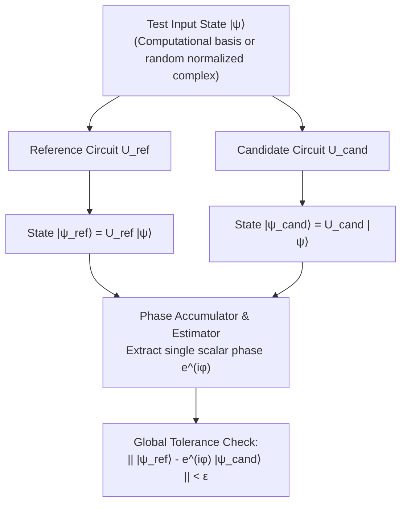
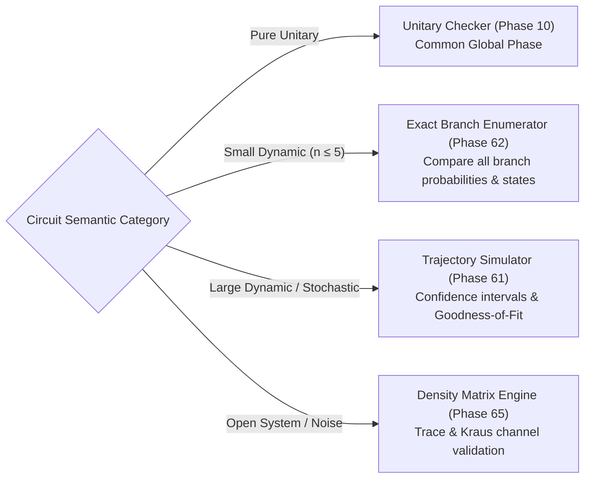

# QCC Correctness and Verification Strategy

## 1. Unitary Equivalence Verification

The global-phase-aware unitary equivalence checker (Phase 10) serves as the primary correctness oracle for all logical transformations, syntheses, and optimizations in QCC.

### 1.1 Mathematical Formulation
Two circuits representing operations $U_A$ and $U_B$ on $n$ qubits are unitarily equivalent if and only if there exists a **single common global phase** $\phi \in [0, 2\pi)$ such that:
$$U_A = e^{i \phi} U_B$$

For any input state $|\psi\rangle$, the output states $|\psi_A\rangle = U_A |\psi\rangle$ and $|\psi_B\rangle = U_B |\psi\rangle$ must satisfy:
$$|\psi_A\rangle = e^{i \phi} |\psi_B\rangle$$

### 1.2 Multi-Tiered Verification Protocol
1. **Exhaustive Basis Testing ($n \le 3$)**: For small qubit counts, the verifier injects all $2^n$ computational basis states $|e_k\rangle$. This reconstructs the entire full-system unitary matrix column-by-column.
2. **Randomized Superposition Testing ($4 \le n \le 8$)**: Using `proptest`, the checker generates random normalized complex statevectors across the Bloch sphere.
3. **Robust Phase Estimation**:
   - Given output amplitudes $\alpha_k$ (reference) and $\beta_k$ (candidate), identify indices where $|\alpha_k| > \epsilon_{\text{threshold}}$.
   - Estimate the candidate phase ratio $r_k = \frac{\alpha_k}{\beta_k}$.
   - Verify that all non-zero components agree with a single scalar phase $e^{i\phi}$ within $\epsilon_{\text{phase}}$.
   - Correctly bypass near-zero amplitudes to prevent division by zero or floating-point instability.
4. **Strict Phase Invariance**: The estimated phase $e^{i\phi}$ must be **identical across all test inputs**. Choosing an independent phase per basis state is strictly prohibited.

---

## 2. Why Measurement Distributions Are Insufficient Oracles

> [!CAUTION]
> **Measurement Distributions Do Not Prove Unitary Equivalence**:
> A compiler pass must **never** be certified solely by comparing output measurement histograms or probability distributions.

Consider two states:
$$|\psi_1\rangle = \frac{|0\rangle + |1\rangle}{\sqrt{2}}, \quad |\psi_2\rangle = \frac{|0\rangle - |1\rangle}{\sqrt{2}}$$
- The computational basis measurement probabilities for both states are identical:
  $$P(|0\rangle) = 0.5, \quad P(|1\rangle) = 0.5$$
- However, applying a subsequent Hadamard gate $H$ reveals that $|\psi_1\rangle$ and $|\psi_2\rangle$ are completely orthogonal:
  $$H |\psi_1\rangle = |0\rangle, \quad H |\psi_2\rangle = |1\rangle$$
A compiler that accidentally replaces $Z$ with an identity or flips relative phase will pass histogram checks while producing completely erroneous computational results.

---

## 3. Numerical Tolerance Hierarchy

Floating-point operations on `Complex64` require distinct, explicit tolerances tailored to each mathematical domain:

| Domain | Tolerance Variable | Value | Purpose |
|---|:---:|:---:|---|
| **Statevector Amplitudes** | $\epsilon_{\text{state}}$ | $1.0 \times 10^{-10}$ | Pointwise amplitude difference between reference and candidate states. |
| **Matrix Reconstruction** | $\epsilon_{\text{matrix}}$ | $1.0 \times 10^{-10}$ | Frobenius norm difference between reconstructed unitary matrices. |
| **Global Phase Coherence** | $\epsilon_{\text{phase}}$ | $1.0 \times 10^{-9}$ | Maximum deviation in estimated phase angle across non-zero amplitudes. |
| **Probability Normalization**| $\epsilon_{\text{prob}}$ | $1.0 \times 10^{-12}$ | Deviation of $\sum_i |\alpha_i|^2$ from exactly $1.0$. |

---

## 4. Verification Strategies for Non-Unitary and Dynamic Circuits

Unitary equivalence checking applies strictly to unitary subcircuits. Circuits containing measurement, reset, or dynamic feedback require dedicated validation methodologies:

1. **Exact Branch Enumeration (Small Systems)**: Evaluates all $2^m$ measurement outcomes explicitly, validating exact branch probabilities and post-collapse statevectors.
2. **Stochastic Trajectory Validation**: Compares empirical shot distributions against analytical distributions using rigorous confidence intervals or Chi-square goodness-of-fit tests with adequate cell counts.
3. **Density Matrix Verification**: For mixed states and noise channels, evaluates $\rho$ directly, verifying trace preservation $\text{Tr}(\rho) = 1$, Hermiticity $\rho^\dagger = \rho$, and positive semidefiniteness $\rho \ge 0$.

---

## 5. Differential Cross-Validation Harness (Design Specification)

> [!NOTE]
> The differential harness cross-validation specification below reflects design architecture from the original roadmap. Active development is currently paused after Phase 59 (Integrated Compilation Pipeline), and the original roadmap past Phase 59 has been retired; future implementation timing is TBD.

To guard against internal implementation bugs in QCC's own statevector simulator, the original architecture outlined a unified differential testing harness cross-checking QCC against independent external quantum ecosystems:

- **Qiskit Aer (Phase 68)**: Independent reference statevector simulation after normalizing for endianness.
- **Cirq / qsim (Phase 69)**: Secondary reference for standard gate sets and rotations.
- **Stim (Phase 70)**: High-speed stabilizer simulation for large Clifford-only circuits ($100+$ qubits).
- **Failure Artifact Persistence (Phase 71)**: Any differential discrepancy automatically dumps a minimized, self-contained reproducer fixture.

