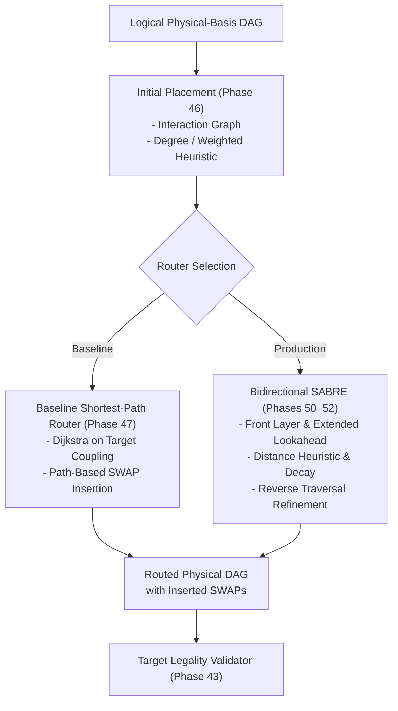

# QCC Target Modeling, Layout, and Circuit Routing

## 1. Generic Target Model

QCC decouples logical quantum circuits from underlying quantum computing hardware through a provider-neutral, generic `Target` data model (Phase 37):

```rust
pub struct Target {
    pub qubit_count: usize,
    pub operations: Vec<TargetOperation>,
    pub connectivity: ConnectivityGraph,
    pub timing: Option<TimingModel>,
    pub calibration: Option<CalibrationData>,
}

pub struct TargetOperation {
    pub gate: GateId,
    pub arity: usize,
    pub parameter_domains: Vec<ParameterDomain>,
    pub allowed_couplings: Option<Vec<(PhysicalQubitId, PhysicalQubitId)>>,
    pub is_directional: bool,
    pub duration: Option<Duration>,
    pub error_estimate: Option<f64>,
}
```

### 1.1 Non-Negotiable Target Principles
1. **No Hardcoded Vendor Bases**: QCC does not hardcode an IBM, Rigetti, or IonQ basis into compiler passes. All gate availability, parameter constraints, and operand orientations are resolved dynamically from `Target`.
2. **Directed vs Undirected Coupling**: An undirected coupling edge for a symmetric gate (such as $CZ$) is not interchangeable with a directed edge for an asymmetric gate (such as $CX(q_{\text{ctrl}}, q_{\text{targ}})$). If a hardware target only supports $CX(1, 0)$, attempting to execute $CX(0, 1)$ without direction correction (Phase 42) is an invariant violation.
3. **Explicit Unknown Principle**: Missing timing or calibration metrics are modeled as `None` (`Unknown`), **never assumed to be zero**. Zero duration or zero error would dangerously warp optimization and scheduling costs.

---

## 2. Injective Layout Representation

Logical qubits ($Q$) and physical device qubits ($P$) are strictly separated by distinct typed identifiers and injective bidirectional mappings (Phase 44):

```rust
#[derive(Clone, Copy, Debug, PartialEq, Eq, Hash)]
pub struct QubitId(pub u32); // Logical qubit

#[derive(Clone, Copy, Debug, PartialEq, Eq, Hash)]
pub struct PhysicalQubitId(pub u32); // Physical hardware qubit

pub struct Layout {
    pub logical_to_physical: HashMap<QubitId, PhysicalQubitId>,
    pub physical_to_logical: HashMap<PhysicalQubitId, QubitId>,
}
```

- **Initial Layout ($L_{\text{initial}}$)**: Physical qubit assignment at circuit entry ($t = 0$).
- **Final Layout ($L_{\text{final}}$)**: Physical qubit assignment at circuit exit ($t = T_{\text{end}}$).
- **Layout Permutations**: Every inserted physical $SWAP$ gate mutates the active layout permutation. Both $L_{\text{initial}}$ and $L_{\text{final}}$ must be preserved and emitted in compilation manifests.

---

## 3. Circuit Routing Architecture



### 3.1 Baseline Shortest-Path Router vs SABRE
QCC explicitly distinguishes between a basic greedy router and SABRE:
- **Baseline Shortest-Path Router (Phase 47)**: A deterministic pathfinding router using Dijkstra's algorithm along coupling edges. Useful as a robust correctness baseline, but **must never be labeled as SABRE**.
- **SABRE (ASPLOS 2019, Li et al.) (Phases 50–52)**: Full implementation of the SABRE algorithm incorporating:
  1. **Front-Layer ($F$) Analysis**: The set of DAG operations whose predecessor dependencies are fully satisfied.
  2. **Extended Lookahead Set ($E$)**: Upcoming dependency-ready operations within a bounded lookahead window.
  3. **Multi-Layer Distance Heuristic**:
     $$H(SWAP) = \frac{1}{|F|} \sum_{g \in F} D(\pi(g_1), \pi(g_2)) + W \cdot \frac{1}{|E|} \sum_{g \in E} D(\pi(g_1), \pi(g_2))$$
     where $D(p_1, p_2)$ is the shortest path distance on the hardware coupling graph and $W$ is the lookahead weight.
  4. **Decay Penalties**: Tracks recent $SWAP$ participation to penalize oscillation.
  5. **Bidirectional Layout Refinement**: Routes the circuit backward to discover an optimal initial layout $L_{\text{initial}}$, then routes forward.

---

## 4. Ancilla and Unused Physical-Qubit Policy (ADR-0001)

When a logical circuit with $m$ logical qubits is mapped onto a physical target with $n > m$ physical qubits, $n - m$ physical qubits act as unused ancillae.

### 4.1 Strict Zero-State Policy
> [!IMPORTANT]
> **Architecture Decision Record ADR-0001**:
> Every physical qubit not assigned to a logical qubit starts in $|0\rangle$ and **must return to $|0\rangle$ at circuit termination**.
>
> QCC rejects the permissive alternative of silently tracing out or discarding extra physical qubits.

### 4.2 Layout-Aware Verification Procedure (Phase 45)
1. **State Embedding**:
   $$|\Psi_{\text{in}}^{\text{phys}}\rangle = \bigotimes_{p=0}^{n-1} |v_p\rangle$$
   where $|v_p\rangle$ is the logical input amplitude for $q_k = L_{\text{initial}}^{-1}(p)$, and $|0\rangle$ for all unmapped physical qubits.
2. **Physical Simulation**: Simulate the routed circuit on the full $n$-qubit register:
   $$|\Psi_{\text{out}}^{\text{phys}}\rangle = U_{\text{routed}} |\Psi_{\text{in}}^{\text{phys}}\rangle$$
3. **Reference Construction**: Place reference logical output state amplitudes into physical positions according to $L_{\text{final}}$, embedding all unmapped physical qubits in state $|0\rangle$:
   $$|\Psi_{\text{expected}}^{\text{phys}}\rangle = \text{embed}(|\psi_{\text{ref}}\rangle, L_{\text{final}}, |0\rangle_{\text{ancilla}})$$
4. **Complete Physical Comparison**: Verify that $|\Psi_{\text{out}}^{\text{phys}}\rangle = e^{i\phi} |\Psi_{\text{expected}}^{\text{phys}}\rangle$ using a single common global phase across all $2^n$ basis amplitudes.
5. **Zero-State Enforcement**: If any ancilla qubit is left entangled with logical qubits or left in state $|1\rangle$, verification fails immediately.

