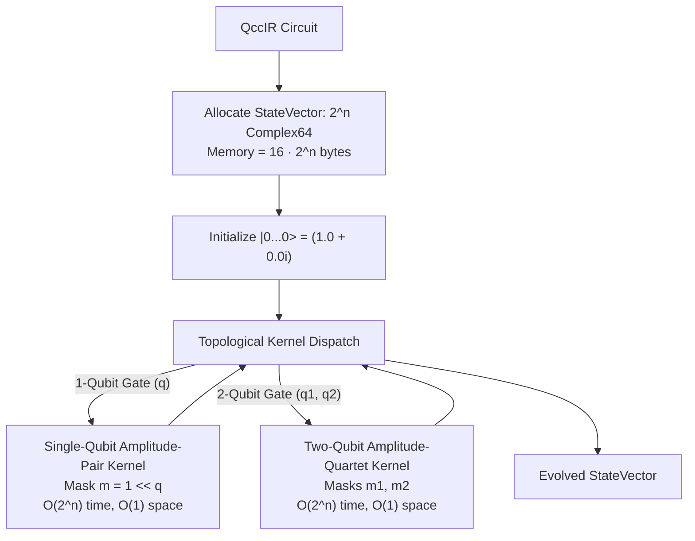
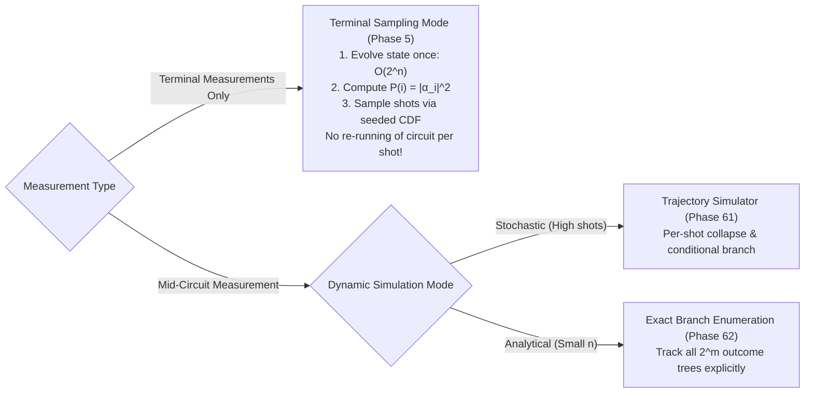

# QCC Simulator Design and Complexity

## 1. Statevector Engine: In-Place Amplitude Kernels

The primary simulation engine in QCC (`qcc-sim-statevector`) is an in-place statevector simulator operating on double-precision complex amplitudes (`num_complex::Complex64`).

### 1.1 Single-Qubit Kernel Mathematics
For a single-qubit gate with unitary matrix $U = \begin{pmatrix} u_{00} & u_{01} \\ u_{10} & u_{11} \end{pmatrix}$ acting on target qubit $q$:
1. Let bitmask $m = 1 \ll q$.
2. Iterate through all basis indices $i \in \{0, 1, \dots, 2^n - 1\}$ where $(i \ \& \ m) == 0$.
3. Form amplitude pairs:
   $$i_0 = i, \quad i_1 = i \mid m$$
4. In-place matrix-vector multiplication:
   $$\begin{pmatrix} \alpha'_{i_0} \\ \alpha'_{i_1} \end{pmatrix} = \begin{pmatrix} u_{00} & u_{01} \\ u_{10} & u_{11} \end{pmatrix} \begin{pmatrix} \alpha_{i_0} \\ \alpha_{i_1} \end{pmatrix}$$
5. **Complexity**: Exactly $2^{n-1}$ pair operations $\implies \mathcal{O}(2^n)$ time, $\mathcal{O}(1)$ auxiliary space.

### 1.2 Two-Qubit Kernel Mathematics
For a two-qubit gate with $4 \times 4$ unitary matrix $U_{4 \times 4}$ acting on operands $q_A$ and $q_B$:
1. Let masks $m_A = 1 \ll q_A$ and $m_B = 1 \ll q_B$.
2. Iterate through all basis indices $i$ where $(i \ \& \ m_A) == 0$ and $(i \ \& \ m_B) == 0$.
3. Extract amplitude quartet:
   $$i_{00} = i, \quad i_{01} = i \mid m_B, \quad i_{10} = i \mid m_A, \quad i_{11} = i \mid m_A \mid m_B$$
4. In-place multiplication:
   $$\begin{pmatrix} \alpha'_{i_{00}} \\ \alpha'_{i_{01}} \\ \alpha'_{i_{10}} \\ \alpha'_{i_{11}} \end{pmatrix} = U_{4 \times 4} \begin{pmatrix} \alpha_{i_{00}} \\ \alpha_{i_{01}} \\ \alpha_{i_{10}} \\ \alpha_{i_{11}} \end{pmatrix}$$
5. **Complexity**: Exactly $2^{n-2}$ quartet operations $\implies \mathcal{O}(2^n)$ time, $\mathcal{O}(1)$ auxiliary space.

> [!IMPORTANT]
> **Strict Anti-Pattern Rule**:
> QCC **never** constructs a dense $2^n \times 2^n$ system matrix for circuit execution. Such an operator requires $2^{2n} \cdot 16$ bytes (e.g., 16 GB for just 15 qubits), which is catastrophic.

---

## 2. Statevector Memory Scaling & Resource Limits

| Qubits ($n$) | Basis States ($2^n$) | Complex64 Statevector Memory ($16 \cdot 2^n$) | Simulation Feasibility |
|:---:|:---:|:---:|---|
| **10** | 1,024 | 16 KiB | Instantaneous / Unit tests |
| **15** | 32,768 | 512 KiB | Instantaneous |
| **20** | 1,048,576 | 16 MiB | Fast local execution |
| **25** | 33,554,432 | 512 MiB | Standard desktop execution |
| **28** | 268,435,456 | 4 GiB | High-memory desktop |
| **30** | 1,073,741,824 | 16 GiB | Maximum practical local limit |

Before allocating state memory, the simulator checks configured resource limits (`max_qubits`, `max_memory_bytes`). If a circuit exceeds the budget, the engine returns a structured `SimulatorError::ResourceLimitExceeded` rather than crashing via out-of-memory abort.

---

## 3. Terminal Sampling vs Dynamic Simulation

QCC strictly separates terminal measurement sampling from dynamic mid-circuit feedback:

### 3.1 Terminal Measurement Mode (Phase 5)
For circuits whose measurements occur exclusively at the end:
1. The unitary circuit evolves **exactly once** to obtain final amplitudes $\alpha_i$.
2. Compute probabilities $p_i = |\alpha_i|^2$.
3. Build a cumulative distribution function (CDF).
4. Draw all $S$ requested shots in $\mathcal{O}(S \log(2^n))$ using binary search.
5. All sampling is seeded for 100% reproducible test output.

### 3.2 Mid-Circuit Measurement Collapse (Design Specification)

> [!NOTE]
> The mid-circuit collapse and density matrix specifications below reflect architectural design specifications from the original roadmap. Active development is currently paused after Phase 59 (Integrated Compilation Pipeline), and the remaining phases have been retired; future implementation timing is TBD.

When a measurement occurs mid-circuit on qubit $q$:
1. Compute marginal outcome probabilities:
   $$P(0) = \sum_{i: (i \, \& \, m) == 0} |\alpha_i|^2, \quad P(1) = 1.0 - P(0)$$
2. Sample outcome bit $b \in \{0, 1\}$ using the seeded RNG.
3. Project statevector onto the outcome subspace:
   $$\alpha_i \leftarrow \begin{cases} \frac{\alpha_i}{\sqrt{P(b)}}, & \text{if bit } q \text{ of } i \text{ equals } b \\ 0, & \text{otherwise} \end{cases}$$
4. Write outcome bit $b$ to the designated classical bit register $c_k$.

---

## 4. Density Matrix Reference Simulator (Design Specification)

For small open systems and mixed-state channel verification, `qcc-sim-density` maintains the full density operator:
$$\rho \in \mathbb{C}^{2^n \times 2^n}, \quad \text{Memory} = 16 \cdot 4^n \text{ bytes}$$

- **Strict Limits**: Enforced strictly for $n \le 10$ due to $\mathcal{O}(4^n)$ memory scaling (10 qubits = 16 MiB; 14 qubits = 4 GiB).
- **Unitary Evolution**: $\rho' = U \rho U^\dagger$.
- **Kraus Channel Maps**: $\rho' = \sum_k K_k \rho K_k^\dagger$ with $\sum_k K_k^\dagger K_k = I$.
- **Partial Trace**: Eliminates unobserved subsystems to compute reduced density matrices for layout and ancilla analysis.

