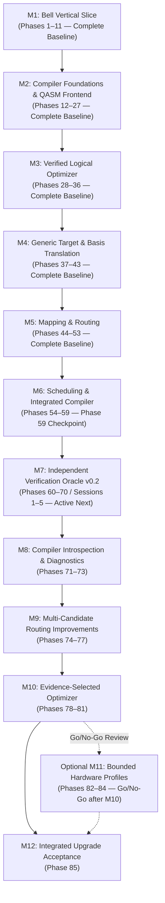

# QCC Milestones and Critical Path (Roadmap v3.1)

> [!NOTE]
> **Active Engineering Plan (Roadmap v3.1 — 12 November 2026)**:
> - **Milestones M1–M6 (Phases 1–59)** are preserved as the completed historical implementation baseline at the **Phase 59 checkpoint**.
> - The previous 105-phase roadmap beyond Phase 59 (old Milestones M7–M9 and Research, Phases 60–105) is **superseded**.
> - **Milestones M7–M12 (Phases 60–85)** form the active continuation, starting with **M7 Session 1**.

## 1. Critical Path Architecture

The preserved critical path is **Phases 1–59**. The active continuation is ordered strictly along the following critical path:

1. **M7 (Phases 60–70, 5 Sessions)**: Independent Verification Oracle & CI Acceptance (**v0.2 checkpoint**) — *Active Next Priority*.
2. **M8 (Phases 71–73)**: Truthful Per-Pass Diagnostics and Introspection *(gated on M7/v0.2 acceptance)*.
3. **M9 (Phases 74–77)**: Bounded Multi-Candidate Routing Improvements.
4. **M10 (Phases 78–81)**: Evidence-Selected Optimizer Improvements *(gated on M7/M9 benchmark evidence identifying a concrete gap)*.
5. **Optional M11 (Phases 82–84)**: Bounded Hardware Profiles *(optional; requires an explicit go/no-go review after M10)*.
6. **M12 (Phase 85)**: Integrated Upgrade Acceptance and Roadmap Closeout.

> [!IMPORTANT]
> **Gating Rules**:
> - **M7/v0.2 is the first stopping point**: Do not begin **M8** until **M7/v0.2** passes its acceptance gate.
> - **Do not begin M10 optimizer work** until oracle and routing benchmark results identify a concrete gap.
> - **M11 hardware profiles are optional** and require an explicit go/no-go decision after M10; they are not a v0.2 or core "compiled right" blocker.
> - **Deferred Tracks**: Noise simulation, density-matrix simulation, dynamic CFG execution, KAK, MPS, and remote provider adapters remain deferred outside Phases 60–85.

---

## 2. Milestone Deliverables Summary

| Milestone | Code | Phases | Status | Primary Deliverable & Exit Hurdle | Critical Path Role |
|---|:---:|:---:|:---:|---|:---:|
| **Bell Vertical Slice** | `M1` | 1–11 | **Complete** | End-to-end Bell circuit: Rust builder $\to$ QccIR DAG $\to$ statevector simulation $\to$ OpenQASM 3 emitter $\to$ independent parse check. | **BASELINE** |
| **Compiler Foundations & QASM Frontend** | `M2` | 12–27 | **Complete** | Pass manager, transactional DAG rewriter, gate algebra, OpenQASM 3 parser, AST, lowering, and round-trip suite. | **BASELINE** |
| **Verified Logical Optimizer** | `M3` | 28–36 | **Complete** | Identity elimination, inverse cancellation, rotation merge, Euler decomposition, one-qubit fusion, and DAG commutation rewrites. | **BASELINE** |
| **Generic Target & Basis Translation** | `M4` | 37–43 | **Complete** | Target hardware model, decomposition templates, single-qubit synthesis, basis translation, direction correction, target legality. | **BASELINE** |
| **Logical-to-Physical Mapping & Routing** | `M5` | 44–53 | **Complete** | Injective layout model, layout-aware equivalence with ADR-0001 ancilla zero-state enforcement, baseline router, and bidirectional SABRE. | **BASELINE** |
| **Scheduling & Integrated Compiler** | `M6` | 54–59 | **Complete** | Target timing/resource model, ASAP/ALAP schedulers, resource-constrained scheduling, end-to-end compilation pipeline. | **CHECKPOINT** |
| **Independent Verification Oracle (v0.2)** | `M7` | 60–70 *(5 Sessions)* | **Active Next (Session 1)** | Versioned compile manifest, pinned Qiskit oracle in `tools/independent_oracle/`, real-QASM import checks, layout/phase/ancilla checks, fault injection, 1,000+ corpus, CI gates, fair comparison report. | **v0.2 GATE** |
| **Compiler Introspection & Diagnostics** | `M8` | 71–73 | **Planned** | Per-pass before/after metrics and truthful verification status (`passed`, `failed`, `not_run`, `unsupported`) in human & JSON reports. | **OBSERVABILITY** |
| **Multi-Candidate Routing Improvements** | `M9` | 74–77 | **Planned** | Reproducible multi-seed/layout SABRE search with deterministic best-candidate selection and comparative benchmarks. | **ROUTING** |
| **Evidence-Selected Optimizer Improvements** | `M10` | 78–81 | **Planned** | One benchmark-gap-selected optimizer improvement, formally specified, safely implemented, and oracle-validated. | **OPTIMIZER** |
| **Bounded Hardware Profiles** | `M11` | 82–84 | **Optional** | Conditional post-M10: validated per-qubit operational properties, directed coupling, and nonuniform gate durations preserving explicit unknowns. | **OPTIONAL** |
| **Integrated Upgrade Acceptance** | `M12` | 85 | **Planned** | Full Rust + Qiskit oracle CI acceptance, reproducible benchmark artifacts, and honest README scope/limitations review. | **CLOSEOUT** |

---

## 3. Plan for First Five Oracle Implementation Sessions (M7 / v0.2)

M7 is executed as **five meaningful implementation/review sessions**. Phase IDs `60`–`70` remain traceability checklists, not eleven isolated commits:

| Session | Focus & Implementation Tasks | Expected Outcome & Exit Hurdle | Effort |
|:---:|---|---|---|
| **1 — Contract & Manifest-First Rust Work** | Inspect Phase 59 compiler results, CLI, layout types, targets, and CI. Finalize the oracle ADR and versioned manifest schema. Implement manifest emission as the first Rust code change; define logical-to-physical layout direction and validate fields against `CompilationResult`. | Tested, machine-readable compile manifest with target, widths, layouts, global phase, compiler identity, output identity, and metrics; no guessed metadata. | **M** |
| **2 — Pinned Environment & Real-QASM Compatibility** | Pin Python, `qiskit`, and `qiskit-qasm3-import`. Import and simulate actual QCC-emitted physical QASM (`rz`, `sx`, `cx`, `gphase`, parameter expressions). Document exact support and semantics-preserving fallback/unsupported behavior. | Reproducible optional environment in `tools/independent_oracle/` and explicit compatibility result for real QCC output; no silent semantic loss. | **M** |
| **3 — Canonical Cases, Runners & Comparator** | Build neutral canonical fixtures and independent Qiskit/QCC adapters. Implement black-box execution, endianness/layout normalization, common-phase semantic comparison, full physical clean-ancilla checking (ADR-0001), and the informational strict phase-accounting diagnostic. | Same logical intent reaches both systems independently; comparator handles layouts, endianness, phase, and ancillas. | **XL** |
| **4 — Fault Injection, Difficult Corpus & Fair Baseline** | Test known-equivalent and deliberately corrupted circuits (manifest phase, layouts, CX orientation, residual/entangled ancillas). Expand deep/non-adjacent/high-SWAP linear and ring cases (1,000+ cases). Run matched-$N$ QCC/Qiskit trials and report spread/time. | Evidence that the oracle detects all intended failure classes, a reproducible difficult corpus, and a fair multi-trial baseline. | **XL** |
| **5 — CI Gate & v0.2 Acceptance** | Integrate required deterministic PR checks and broader seeded main/release/scheduled runs. Preserve complete failure artifacts, publish machine-readable and README results, verify all sources, and complete the v0.2 acceptance report. | Independent oracle is a permanent in-repository CI regression capability; v0.2 acceptance is evidence-backed. | **L** |

---

## 4. Engineering Effort & Timeline Grounding

- Effort labels (`XS`, `S`, `M`, `L`, `XL`) signify **relative engineering complexity**, not calendar commitments or delivery dates.
- Roadmap v3.1 is a multi-month learning and engineering project. Execute one defined session or phase at a time, review exit-gate evidence, and stop if an unresolved correctness issue arises.
