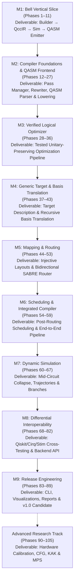

# QCC Milestones and Critical Path

## 1. Critical Path Architecture

The 105 implementation phases of QCC are sequenced along a strictly validated critical path. Each milestone concludes with a concrete, testable deliverable that acts as the exit gate for downstream development:

---

## 2. Milestone Deliverables Summary

| Milestone | Code | Phases | Primary Deliverable & Exit Hurdle | Critical Path Role |
|---|:---:|:---:|---|:---:|
| **Bell Vertical Slice** | `M1` | 1–11 | End-to-end working Bell circuit: Rust builder $\to$ QccIR DAG $\to$ statevector simulation $\to$ valid OpenQASM 3 emitter $\to$ independent parser verification. | **FOUNDATIONAL** |
| **Compiler Foundations & QASM Frontend** | `M2` | 12–27 | Pass manager interface, transactional DAG rewriter, gate algebra, OpenQASM 3 parser, AST, lowering, and independent round-trip suite. | **CORE** |
| **Verified Logical Optimizer** | `M3` | 28–36 | Identity elimination, inverse cancellation, rotation merging, Euler decomposition, one-qubit fusion, and DAG-aware commutation rewrites. | **CORE** |
| **Generic Target & Basis Translation** | `M4` | 37–43 | Target hardware model, decomposition templates, single-qubit native synthesis, recursive basis translation, direction correction, target legality. | **CORE** |
| **Logical-to-Physical Mapping & Routing** | `M5` | 44–53 | Injective layout model, layout-aware equivalence with ADR-0001 ancilla zero-state enforcement, baseline router, and bidirectional SABRE. | **CORE** |
| **Scheduling & Integrated Compiler** | `M6` | 54–59 | Target timing/resource model, ASAP/ALAP schedulers, resource-constrained scheduling on final routed DAG, end-to-end pipeline report. | **CORE** |
| **Dynamic Simulation & Non-Unitary** | `M7` | 60–67 | Mid-circuit measurement collapse, stochastic trajectories, bounded exact branches, non-unitary reset, density matrix reference, noise models. | **CORE** |
| **Differential Validation & Backends** | `M8` | 68–82 | Qiskit Aer/Cirq/Stim differential test harness, provider-neutral backend API, OpenQASM execution artifacts, optional provider adapters. | **CORE** |
| **Developer Experience & Release** | `M9` | 83–89 | Full CLI (`compile`, `simulate`, `optimize`, `route`, `verify`, `inspect`), ASCII/SVG visualization, compilation reports, manifests, v1.0 release. | **RELEASE** |
| **Advanced Research Track** | `Research` | 90–105 | Post-v1.0 research: calibration costs, user-defined gates, CFG representation with branches/loops, arbitrary KAK synthesis, MPS simulation. | **OPTIONAL** |

---

## 3. Plan for First Five Coding Sessions

The first five implementation sessions directly execute the initial five phases of Milestone M1, establishing the mathematical and simulation core:

| Session | Roadmap Phase | Focus & Implementation Tasks | Expected Outcome & Exit Hurdle | Effort |
|:---:|:---:|---|---|:---:|
| **1** | **Phase 1** | **Repository Scaffold & CI**: Initialize Cargo package, rustfmt, Clippy, typed `errors.rs`, diagnostic span types, minimal CLI version command, smoke test, and `.github/workflows/ci.yml`. | Clean checkout builds, tests, and passes CI on stable Rust. | **M** |
| **2** | **Phase 2** | **Quantum Semantics & Gates**: Little-endian bit ordering, Dirac notation convention, column vectors, circuit multiplication order ($B \cdot A$), gate catalog, fixed/parameterized matrices, and unitarity verification suite. | All initial gate matrices have verified mathematical proofs and $U^\dagger U = I$ tests. | **M** |
| **3** | **Phase 3** | **Single-Qubit Statevector Kernels**: `StateVector` with $2^n$ `Complex64` amplitudes, basis initialization, in-place amplitude-pair kernel for target bit $q$, and gates ($X, Y, Z, H, S, S^\dagger, T, T^\dagger, R_x, R_y, R_z$). | $\mathcal{O}(2^n)$ runtime; randomized tests confirm norm preservation and $H|0\rangle = \frac{|0\rangle + |1\rangle}{\sqrt{2}}$. | **M** |
| **4** | **Phase 4** | **Two-Qubit Statevector Kernels**: Amplitude-quartet kernel across two bitmasks, $CX$ (operand 0 = control, operand 1 = target), $CZ$, and $SWAP$, testing both control/target orientations and non-adjacent qubits. | Bell state amplitudes $[1/\sqrt{2}, 0, 0, 1/\sqrt{2}]$ under $q_0$-LSB convention; $\mathcal{O}(2^n)$ runtime. | **L** |
| **5** | **Phase 5** | **Terminal Measurement & Sampling**: Compute probabilities $P(i) = |\alpha_i|^2$, seeded RNG interface, cumulative distribution sampling, and classical result formatting. | Bell circuit produces only `00` and `11` bitstrings deterministically under a fixed seed. | **M** |

Following Session 5, development proceeds sequentially through DAG QccIR (Phase 6), Rust Builder API (Phase 7), DAG Execution Adapter (Phase 8), OpenQASM 3 Emitter (Phase 9), Unitary Equivalence Checker (Phase 10), and the Bell Vertical Slice Acceptance Gate (Phase 11).

---

## 4. Engineering Effort & Timeline Grounding

- Effort labels (`XS`, `S`, `M`, `L`, `XL`) signify **relative engineering complexity**, architectural depth, and risk.
- They are **not calendar commitments**. QCC is a comprehensive, deep compiler and quantum mathematics engineering project.
- Rushing through phases without satisfying exit gates will inevitably cause downstream architectural collapse. Downstream phases must remain strictly blocked until their dependencies have been proven.

