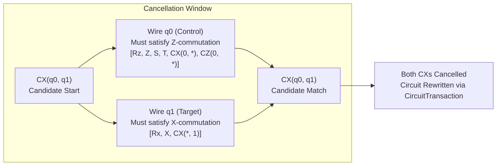

# QCC Specification — Commutative Two-Qubit (CX/CZ) Cancellation

```text
Specification: Commutative Two-Qubit (CX/CZ) Cancellation
Milestone: Milestone M10 — Evidence-Selected Optimizer Improvements
Phase: Phase 79 (Specification & Proof Obligations)
Target Implementation: Phase 80 (CommutativeCancellationPass)
Status: Approved Formal Specification
Authoritative ADR: docs/decisions/ADR-0005-evidence-selected-optimizer-priority.md
```

---

## 1. Executive Summary & Scope Boundary

In Phase 78, rigorous gap analysis and static corpus audits established that QCC's primary competitive deficit against Qiskit is two-qubit ($CX$) gate count (0 QCC wins vs 13 Qiskit wins across the Phase 70 benchmark). QCC's standard `OptimizationLevel::O2` pipeline includes `InverseCancellationPass`, but this pass strictly requires candidate gate pairs to be directly wire-adjacent on all shared quantum wires. Intervening operations that mathematically commute with the control or target operands prevent cancellation, leaving **165 logical cancellation pairs across 82 cases** ($7.6\%$ of the verified corpus) unoptimized. Speculative topological node reordering in `O3` (`CommutationReorderPass`) proved unstable, inducing depth regressions and compile slowdowns.

Through **ADR-0005**, QCC formally selected **Commutative Two-Qubit (CX/CZ) Cancellation** as the single bounded optimizer improvement for Milestone M10 (Phases 78–81).

### Scope Governance & Non-Negotiable Invariants
1. **Phase 79 Scope**: This document and its associated test suite (`tests/optimizer/commutative_cancellation_spec.rs`) define the **exact mathematical contracts, dependency preconditions, boundary rules, and local proof obligations**. The 24 automated algebraic rule tests establish executable proof obligations (matrix commutator bounds, circuit equivalence checks, and negative fixtures); they do **not** constitute a formal machine-checked proof (such as in Coq, Lean, or Isabelle) of the full optimizer. **No compiler passes or QccIR mutations are implemented in Phase 79** (implementation is strictly isolated to Phase 80).
2. **Deterministic & Safe**: The pass operates via targeted forward DAG wire reachability. It executes zero heuristic swaps, zero speculative reorderings, and requires no randomized seeds.
3. **Exact Global Phase**: Two-qubit self-inverse cancellation ($CX^2 = I$, $CZ^2 = I$) produces the exact identity operator with zero net global phase adjustment ($\Delta \phi = 0$).
4. **Target-Independent Logical Optimization**: The rule operates on logical QccIR within basic blocks prior to hardware target translation and routing.

---

## 2. Mathematical Formulation & Identity Contracts

### 2.1 Core Cancellation Identities & Sufficient-Condition Theorem

Let $\mathcal{H} = (\mathbb{C}^2)^{\otimes n}$ be the state space of an $n$-qubit quantum system with little-endian indexing ($q_0$ is LSB). Let $G$ be a self-inverse two-qubit unitary operator ($G^2 = I$), and let $\{O_1, O_2, \dots, O_m\}$ be a sequence of $m$ intervening operations ($O_m \dots O_1$ in circuit execution order, acting leftward on statevectors).

#### Sufficient-Condition Cancellation Theorem
If every intervening operation $O_k$ individually commutes with $G$ ($[G, O_k] = 0$ for all $k \in \{1, \dots, m\}$) and $G^2 = I$, then:
$$G \cdot \left( \prod_{k=1}^m O_k \right) \cdot G = \prod_{k=1}^m O_k$$

*Proof*:
Because each $O_k$ individually commutes with $G$ ($G \cdot O_k = O_k \cdot G$), $G$ commutes past the entire composite sequence step by step:
$$G \cdot \left( O_m \cdot O_{m-1} \cdots O_1 \right) \cdot G = \left( O_m \cdot O_{m-1} \cdots O_1 \right) \cdot G \cdot G$$
Since $G$ is self-inverse ($G^2 = I$):
$$\left( O_m \cdot O_{m-1} \cdots O_1 \right) \cdot G^2 = \left( \prod_{k=1}^m O_k \right) \cdot I = \prod_{k=1}^m O_k \quad \blacksquare$$

Applying this general theorem separately to $CX$ and $CZ$:

#### 1. Commutative Controlled-NOT ($CX$) Cancellation
For $G = CX(c, t)$ on control qubit $c$ and target qubit $t$ ($c \neq t$):
Since $CX(c, t)^\dagger = CX(c, t)$ and $CX(c, t)^2 = I_4$:
$$\left( \forall k \in \{1, \dots, m\}, \quad [CX(c, t), O_k] = 0 \right) \implies CX(c, t) \cdot \left( \prod_{k=1}^m O_k \right) \cdot CX(c, t) = \prod_{k=1}^m O_k$$

#### 2. Commutative Controlled-$Z$ ($CZ$) Cancellation
For $G = CZ(a, b)$ on qubits $a$ and $b$ ($a \neq b$):
Since $CZ(a, b)^\dagger = CZ(a, b)$ and $CZ(a, b)^2 = I_4$:
$$\left( \forall k \in \{1, \dots, m\}, \quad [CZ(a, b), O_k] = 0 \right) \implies CZ(a, b) \cdot \left( \prod_{k=1}^m O_k \right) \cdot CZ(a, b) = \prod_{k=1}^m O_k$$

---

### 2.2 Conservative Sufficient Condition vs. Necessary Condition

It is mathematically vital to distinguish between a **sufficient condition** and a **necessary condition** for circuit cancellation:
- **Necessary Condition for Cancellation**: Two identical self-inverses cancel across an intervening block $U_{\text{block}} = \prod_{k=1}^m O_k$ if and only if the *composite unitary operator* $U_{\text{block}}$ as a whole commutes with $G$:
  $$G \cdot U_{\text{block}} \cdot G = U_{\text{block}} \iff [G, U_{\text{block}}] = 0$$
- **Conservative Sufficient Condition**: Requiring that *every individual operation* $O_k$ commutes with $G$ ($\forall k, [G, O_k] = 0$) is a **conservative sufficient condition**, not a necessary condition.
  For example, an intervening subcircuit could consist of operations that do not commute individually with $G$, but whose composite product synthesizes an operator commuting with $G$ (such as $H \cdot H = I$, or non-commuting rotations $R_x(\pi) \cdot R_z(\pi) = -i Y$ that collectively commute or cancel in context).
- **Compiler Design Rationale**: A DAG-based wire-traversal optimizer enforces this conservative sufficient condition because verifying local pairwise commutation rules on individual operations along DAG wire paths is $\mathcal{O}(m)$ and strictly avoids computing or synthesizing dense $2^n \times 2^n$ block unitaries. Intervening blocks that commute collectively as a whole but contain individually non-commuting sub-operations are conservatively rejected by the pass to preserve local tractability, algorithmic determinism, and zero-heuristic safety.

---

### 2.3 Gate Identity & Operand Order Invariants

A critical requirement is the formal distinction between directed operations and symmetric operations:

#### 1. CX Ordered Operand Identity (Directional)
$CX(c, t)$ has strict, asymmetric operand semantics: operand 0 is control, operand 1 is target.
$$CX(c, t) = |0\rangle\langle 0|_c \otimes I_t + |1\rangle\langle 1|_c \otimes X_t$$
$$CX(t, c) = I_c \otimes |0\rangle\langle 0|_t + X_c \otimes |1\rangle\langle 1|_t$$

Reversing control and target yields an entirely distinct unitary transformation related by SWAP:
$$CX(c, t) \cdot CX(t, c) = SWAP(c, t) \cdot CX(c, t) \neq I_4$$
$$\|CX(c, t) \cdot CX(t, c) - I_4\|_F = \sqrt{\text{Tr}((CX_{ct}CX_{tc} - I)^\dagger(CX_{ct}CX_{tc} - I))} = \sqrt{6} \approx 2.4495$$

> [!CAUTION]
> **Ordered CX Invariant**: For direct self-inverse cancellation ($CX \cdot CX = I$), ordered operand identity is required: operand 0 must be control, and operand 1 must be target. A candidate pair $(G_1, G_2)$ of $CX$ gates is eligible for commutative cancellation only when:
> $$\text{Operands}(G_1) = (c_1, t_1) \quad \land \quad \text{Operands}(G_2) = (c_2, t_2) \quad \land \quad c_1 = c_2 \quad \land \quad t_1 = t_2$$
> Reversed operands ($c_1 = t_2 \land t_1 = c_2$) represent **non-commuting, non-identical** operations that do not directly self-cancel, and must strictly terminate the cancellation search.

#### 2. CZ Symmetric Operand Identity (Commutative in Operands)
$CZ(a, b)$ is a diagonal operator in the computational basis:
$$CZ(a, b) = \text{diag}(1, 1, 1, -1) = I - 2 |11\rangle\langle 11|_{ab}$$
Because $|11\rangle\langle 11|_{ab} = |1\rangle\langle 1|_a \otimes |1\rangle\langle 1|_b = |1\rangle\langle 1|_b \otimes |1\rangle\langle 1|_a$, $CZ$ is inherently symmetric under operand interchange:
$$CZ(a, b) \equiv CZ(b, a)$$
$$CZ(a, b) \cdot CZ(b, a) = CZ(a, b)^2 = I_4$$

> [!TIP]
> **Symmetric CZ Normalization**: The cancellation pass must normalize $CZ$ operands to canonical ascending index order:
> $$\text{CanonicalCZ}(a, b) \triangleq (\min(a, b), \max(a, b))$$
> This guarantees that $CZ(0, 1)$ followed across commuting operations by $CZ(1, 0)$ correctly identifies the pair as identical and self-annihilating.

#### 3. Cross-Type Pair Prohibition
Cross-type pairs ($CX$ with $CZ$) are non-cancelling:
$$CX(c, t) \cdot CZ(c, t) \neq I_4$$
A $CX$ gate can never cancel with a $CZ$ gate, regardless of operand overlap.

---

## 3. Comprehensive Commutation Algebra & Preconditions

To guarantee that intervening operations $O_k$ commute with the candidate two-qubit gate, the pass validates every intervening node against the mathematically proven commutation rules established in Phase 78.

### 3.1 Commutation Matrix for $CX(c, t)$ and $CZ(a, b)$

| Intervening Operation $O$ | Position relative to $CX(c, t)$ | Commutes with $CX$? | Position relative to $CZ(a, b)$ | Commutes with $CZ$? | Formal Mathematical Justification |
| :--- | :--- | :---: | :--- | :---: | :--- |
| **$R_z(\theta), P(\lambda)$** | Control wire $c$ | **YES** | Either wire $a$ or $b$ | **YES** | Both $CX$ control ($|k\rangle\langle k|$) and $CZ$ operands are diagonal in the $Z$-basis ($[D_1, D_2] = 0$). Holds $\forall \theta \in \mathbb{R}$. |
| **$R_z(\theta), P(\lambda)$** | Target wire $t$ | **NO** | N/A | N/A | Non-commuting: $[R_z(\theta), X] = -2i\sin(\theta/2)Y \neq 0$ for $\theta \not\equiv 0 \pmod{2\pi}$. (Anti-commutes only at $\theta \equiv \pi$). |
| **$R_x(\theta)$** | Target wire $t$ | **YES** | Either wire $a$ or $b$ | **NO** | On target wire $t$, $[e^{-i\theta X/2}, X] = 0$. On $CZ$, non-commuting: $[R_x(\theta), Z] = 2i\sin(\theta/2)Y \neq 0$. |
| **$R_x(\theta)$** | Control wire $c$ | **NO** | N/A | N/A | Non-commuting: $[e^{-i\theta X/2}, |1\rangle\langle 1|] \neq 0$. |
| **$Z, S, S^\dagger, T, T^\dagger$** | Control wire $c$ | **YES** | Either wire $a$ or $b$ | **YES** | Computational-basis diagonal operators commute with $Z$-projectors ($[Z, |k\rangle\langle k|] = 0$). |
| **$Z, S, S^\dagger, T, T^\dagger$** | Target wire $t$ | **NO** | N/A | N/A | Pauli $Z$ anti-commutes with target flip ($XZ = -ZX \implies \{X, Z\} = 0 \implies [X, Z] \neq 0$). $S, T$ are non-commuting with $X$. |
| **$X$** | Target wire $t$ | **YES** | Either wire $a$ or $b$ | **NO** | On $CX$ target, $[X, X] = 0$. On $CZ$, $X$ anti-commutes with diagonal Pauli $Z$ ($\{X, Z\} = 0 \implies [X, Z] \neq 0$). |
| **$X$** | Control wire $c$ | **NO** | N/A | N/A | Non-commuting: $X$ flips the control state ($X |k\rangle = |1-k\rangle$), changing the conditional activation condition. |
| **$Y, R_y(\theta)$** | Any wire ($c$ or $t$) | **NO** | Either wire $a$ or $b$ | **NO** | Pauli $Y$ anti-commutes with both $X$ and $Z$ ($\{Y, X\} = \{Y, Z\} = 0$). $R_y(\theta)$ is non-commuting with both axes ($[R_y, X] \neq 0, [R_y, Z] \neq 0$). |
| **$H$ (Hadamard)** | Any wire ($c$ or $t$) | **NO** | Either wire $a$ or $b$ | **NO** | Non-commuting: Hadamard interchanges the $X$ and $Z$ axes ($H X H = Z, H Z H = X$). |
| **$SX = \sqrt{X}$** | Target wire $t$ | **Conservative NO** | Either wire $a$ or $b$ | **NO** | While $[X^{1/2}, X] = 0$ holds algebraically, QCC conservatively rejects $SX$ unless normalized to $R_x(\pi/2)$ to prevent gate-catalog ambiguities. |
| **Disjoint Single-Qubit** | Qubits $q \notin \{c, t\}$ | **YES** | Qubits $q \notin \{a, b\}$ | **YES** | Distinct tensor product factors strictly commute: $(A \otimes I)(I \otimes B) = (I \otimes B)(A \otimes I)$. |
| **$CX(c, t_2)$** | Shared control $c$ ($t \neq t_2$) | **YES** | N/A | N/A | Both gates project onto $|1\rangle\langle 1|_c$; target operators $X_t \otimes I_{t_2}$ and $I_t \otimes X_{t_2}$ commute. |
| **$CX(c_2, t)$** | Shared target $t$ ($c \neq c_2$) | **YES** | N/A | N/A | Both apply $X_t$ conditionally; control projectors on disjoint wires commute. |
| **$CX(t, c)$** | Reversed operands | **NO** | N/A | N/A | Non-commuting: $CX(c, t) \cdot CX(t, c) = SWAP(c, t) \cdot CX(c, t) \neq CX(t, c) \cdot CX(c, t)$. |
| **$CX(a, b)$ chained** | Target is control ($t = c_2$) | **NO** | N/A | N/A | Non-commuting: chained dependency causes operator mixing between $X$ and $Z$. |
| **$CZ(q_0, q_1)$** | Overlaps only on $c$ ($t \notin \{q_0, q_1\}$) | **YES** | Any overlap with $CZ$ | **YES** | All $CZ$ gates are mutually diagonal ($D_1 D_2 = D_2 D_1$). $CX$ control is diagonal in $Z$. |
| **$CZ(q_0, q_1)$** | Overlaps on $t$ ($t \in \{q_0, q_1\}$) | **NO** | N/A | N/A | Non-commuting: $CZ$ applies conditional $Z_t$, which anti-commutes with $X_t$ ($\{X_t, Z_t\} = 0$). |
| **$SWAP$** | Any overlap | **NO** | Any overlap | **NO** | Permutes physical wire semantics; strictly terminates the cancellation path. |
| **Classical Hazards** | Any wire in hazard set | **NO** | Any wire in hazard set | **NO** | RAW, WAR, WAW classical dependencies must be strictly preserved. |
| **Non-Unitary Ops** | `Measure`, `Reset`, `Barrier` | **NO** | `Measure`, `Reset`, `Barrier` | **NO** | State collapse and synchronization barriers are impenetrable boundaries. |

---

## 4. DAG Wire Reachability & Dependency Preconditions

Instead of bubbling gates via adjacent swaps, the pass performs a targeted, forward reachability traversal along quantum wire paths on the QccIR DAG.



### 4.1 Traversal Preconditions & Boundary Invariants
1. **Basic Block Confinement**: Traversal begins and ends within the same `BasicBlock`. It never crosses basic block boundaries or dynamic control flow (`if`, `while`, `for`).
2. **Impenetrable Non-Unitary Boundaries**:
   - `Barrier`: Synchronization barriers prevent any gate from commuting across them.
   - `Measure`: Measurement projects the quantum state into an eigenstate, terminating quantum coherence.
   - `Reset`: Non-unitary state initialization destroys prior state information.
   If any path from $G_1$ encounters a barrier, measure, or reset before reaching $G_2$, the candidate pair is rejected.
3. **Classical Wire Hazards**:
   - Quantum operations conditioned on classical registers or emitting classical bits must preserve **Read-After-Write (RAW)**, **Write-After-Read (WAR)**, and **Write-After-Write (WAW)** orderings via `WireAccessState`.
   - Any classical hazard on either wire path aborts the cancellation search.
4. **Intervening Multi-Qubit Operations Touching Both Operands**:
   - If an intervening operation touches both control $c$ and target $t$, it must be an identical gate to commute.
   - Any other multi-qubit operation on $\{c, t\}$ (reversed $CX$, $CZ$, $SWAP$, or higher-arity gate) strictly terminates search on both wires.
5. **Convergence and Acyclicity**:
   - For a candidate pair $(G_1, G_2)$ to cancel, $G_2$ must be reachable from $G_1$ along **both** operand wires simultaneously.
   - If $G_2$ is reached on wire $c$ but wire $t$ encounters an intervening non-commuting gate or an unrelated operation that branches away from $G_2$, cancellation is prohibited.

---

## 5. Global Phase, Numerical Tolerances & Parameter Handling

### 5.1 Exact Global Phase Preservation ($\Delta \phi = 0$)
- In QCC, circuit global phase is explicitly tracked: $U_{\text{circuit}} = e^{i\phi} U_{\text{operations}}$.
- Because $CX^2 = I_4$ and $CZ^2 = I_4$, eliminating a valid pair leaves the statevector algebraically identical:
  $$U_{\text{before}} = U_{\text{after}}$$
  $$\Delta \phi = 0.0$$
- No phase correction factors ($e^{i\pi}$, $e^{i\pi/2}$) are introduced. The circuit's global phase accumulator remains completely unchanged.

### 5.2 Symbolic Parameter Reasoning vs. Concrete Numerical Tests
- **Symbolic Algebraic Property**: Commutation rules for $R_z(\theta)$ on control and $R_x(\theta)$ on target hold identically for **all** angles $\theta \in \mathbb{R}$:
  $$[|k\rangle\langle k|, e^{-i\theta Z/2}] = 0 \quad \forall \theta$$
  $$[X, e^{-i\theta X/2}] = 0 \quad \forall \theta$$
  In QccIR, rotation gates with **unresolved symbolic parameters** (e.g. `ParameterExpr::Variable("theta")`) commute validly without requiring concrete numerical evaluation.
- **Concrete Numerical Test Distinction**: While algebraic commutation holds symbolically for all $\theta \in \mathbb{R}$, statevector simulators and matrix verifiers compute with floating-point numbers. The automated test suite (`tests/optimizer/commutative_cancellation_spec.rs`) distinguishes:
  - **Concrete Numerical Matrix Tests**: Evaluates exact commutators on complex matrices using Frobenius norm tolerances ($\|[A, B]\|_F < 10^{-12}$).
  - **Concrete Angle Sweeps**: Verifies statevector equivalence across concrete irrational, rational, and boundary angles ($0, 0.123, \pi/4, \pi/2, \pi, 3\pi/2, -1.876$).
  - **Symbolic Reasoning**: Governed by QCC's `CommutationRegistry` which verifies that variable parameters on recognized rotation axes commute without binding.

### 5.3 Numerical Tolerances for Concrete Matrix Tests
- In the 24 automated algebraic rule tests (`tests/optimizer/commutative_cancellation_spec.rs`), commutators $[A, B] = AB - BA$ are evaluated using Frobenius norm on concrete numerical matrices:
  $$\|[A, B]\|_F = \sqrt{\sum_{i,j} |(AB - BA)_{ij}|^2}$$
- Acceptance threshold for commuting pairs: $\|[A, B]\|_F < 10^{-12}$.
- Rejection threshold for non-commuting pairs: $\|[A, B]\|_F > 10^{-2}$.

---

## 6. Deterministic Traversal, Candidate Selection & Idempotence

### 6.1 Order of Traversal
To guarantee strict determinism across compilers and operating systems:
1. Candidate first gates $G_1$ are scanned in ascending topological order by `OperationId`.
2. For each candidate $G_1 \in \{CX, CZ\}$:
   - Perform forward reachability search on both operand wires up to a bounded depth or block termination.
   - Find the earliest valid matching gate $G_2$ such that all intervening operations along both wire paths commute.
3. **Greedy Non-Overlapping Selection**:
   - When a valid cancellation pair $(G_1, G_2)$ is identified, both $G_1$ and $G_2$ are marked as **consumed**.
   - Neither $G_1$ nor $G_2$ may participate in any subsequent cancellation pair.
   - If a chain of three identical gates $CX_1 \dots CX_2 \dots CX_3$ occurs across commuting operations, $CX_1$ and $CX_2$ are cancelled, leaving $CX_3$ in the circuit.

### 6.2 Transactional Atomicity via `CircuitTransaction`
- Node removal and wire edge reconnection must execute atomically using `CircuitTransaction::remove_operation`.
- If DAG validation fails or an unexpected cycle is detected, the transaction rolls back cleanly, leaving the circuit in its pre-pass state.

### 6.3 Idempotence
- Commutative cancellation is strictly non-increasing: it only deletes gates, never adds or substitutes gates.
- Running the pass a second time on the resulting circuit will find zero candidate pairs, perform zero mutations, and report `modified = false`.
- The pass avoids the loop oscillation seen in `CommutationReorderPass`.

---

## 7. Pass Telemetry & Diagnostic Report Schema

In compliance with Milestone M8 (Phase 71 `PassDiagnosticReport`), the implementation in Phase 80 must record comprehensive diagnostic telemetry:

```json
{
  "pass_name": "commutative_cancellation",
  "pass_order": 3,
  "execution_time_ns": 45210,
  "modified": true,
  "operations_added": 0,
  "operations_removed": 4,
  "operations_rewritten": 0,
  "metrics_before": {
    "total_gates": 28,
    "cx_count": 8,
    "cz_count": 2,
    "depth": 14
  },
  "metrics_after": {
    "total_gates": 24,
    "cx_count": 6,
    "cz_count": 0,
    "depth": 12
  },
  "custom_diagnostics": {
    "candidate_pairs_examined": 10,
    "cancellation_pairs_accepted": 2,
    "cx_pairs_cancelled": 1,
    "cz_pairs_cancelled": 1,
    "rejection_reasons": {
      "non_commuting_target_operation": 3,
      "non_commuting_control_operation": 2,
      "barrier_encountered": 1,
      "reversed_operands": 1,
      "wire_divergence": 1
    }
  },
  "verification_status": "passed"
}
```

---

## 8. Measurable Objective & Acceptance Gate Criteria

The pass implementation in Phase 80 must satisfy the following acceptance criteria:
1. **Monotonic Gate Reduction**:
   $$\Delta \text{total\_gates} \le 0 \quad \land \quad \Delta \text{two\_qubit\_gates} \le 0 \quad \land \quad \Delta \text{depth} \le 0$$
   The pass must never increase circuit gate count or depth.
2. **Strict Unitary Equivalence**:
   $$100\% \text{ PASS on Phase 10 Unitary Equivalence Checker} \quad (\Delta \phi = 0)$$
   Every cancelled circuit must be bit-for-bit unitarily equivalent to its input.
3. **Targeted Opportunity Capture**:
   When run on the 82 corpus cases identified in Phase 78, the pass must eliminate the audited **165 logical cancellation pairs** (163 CX pairs, 2 CZ pairs), removing **330 logical two-qubit operations**.
4. **Zero Regressions on Canonical Benchmarks**:
   Pass must produce zero regressions on the 18 canonical Phase 70 fair Qiskit benchmark workloads.
