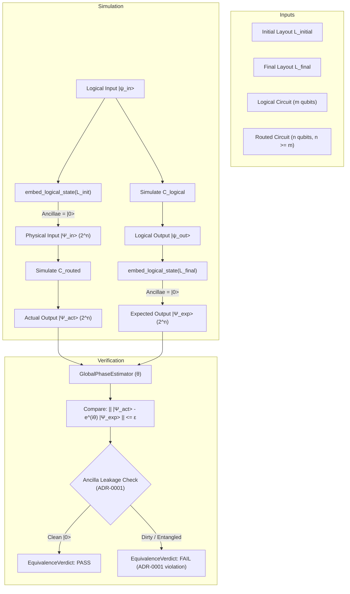

# Phase 45 Completion Report — Layout-Aware Equivalence

## 1. Executive Summary

- **Phase Number**: Phase 45
- **Phase Title**: Layout-aware equivalence
- **Milestone**: Milestone M5: Logical-to-Physical Mapping and Routing (`M5`)
- **Exit Gate**: All router tests use layout-aware semantic comparison; correctly routed circuits pass; incorrect final permutations fail; unused physical qubits satisfy the mandatory $|0\rangle$ ancilla policy (**PASSED**; router pass algorithms are scheduled for Phases 47–53 and do not yet exist, but all routing fixtures and layout equivalence tests strictly use layout-aware semantic comparison)
- **Baseline Git Checkpoint**: `463d316` (`feat(phase-44): implement logical physical layout model`)
- **Status**: Completed and fully verified with 100% test pass across all targets.

Phase 45 implements **Layout-Aware Equivalence Verification** for the Quantum Circuit Compiler (QCC). It provides the critical semantic verification oracle for circuit routing, confirming that routed physical circuits $C_{\text{routed}}$ correctly execute the unitary transformation of unrouted logical circuits $C_{\text{logical}}$ after accounting for initial placement ($L_{\text{initial}}$) and final layout permutations ($L_{\text{final}}$), while strictly validating the ADR-0001 zero-state requirement on all unused physical ancillae over the complete $2^n$-dimensional statevector.

Key architectural deliverables:
1. **Little-Endian State Embedding ([`src/verification/layout_equivalence.rs`](file:///home/ronanki_jitendra/rust/QCC/src/verification/layout_equivalence.rs))**:
   - Implemented [`embed_logical_state`](file:///home/ronanki_jitendra/rust/QCC/src/verification/layout_equivalence.rs#L39-L92): Ingests a $2^m$ logical statevector and embeds it into a $2^n$ physical register under a layout $L$, placing logical amplitudes at the exact physical bit positions corresponding to each assigned qubit (`q[j]` at bit `p_j = L.get_physical(q[j])`).
   - Every physical qubit not occupied by a logical qubit has bit value 0 across all basis states, strictly enforcing the $|0\rangle$ ancilla condition required by ADR-0001.
2. **Layout-Aware Equivalence Checker ([`src/verification/layout_equivalence.rs`](file:///home/ronanki_jitendra/rust/QCC/src/verification/layout_equivalence.rs))**:
   - Implemented [`LayoutEquivalenceChecker`](file:///home/ronanki_jitendra/rust/QCC/src/verification/layout_equivalence.rs#L101-L105) and [`check_layout_equivalence`](file:///home/ronanki_jitendra/rust/QCC/src/verification/layout_equivalence.rs#L332-L338).
   - Validates that:
     1. Logical input $|i\rangle$ is embedded into physical input $|\Psi_{\text{in}}^{\text{phys}}\rangle$ under $L_{\text{initial}}$ with all ancillae in $|0\rangle$.
     2. Routed circuit $C_{\text{routed}}$ evolves $|\Psi_{\text{in}}^{\text{phys}}\rangle \to |\Psi_{\text{out}}^{\text{phys}}\rangle$.
     3. Logical reference circuit $C_{\text{logical}}$ evolves $|i\rangle \to |\psi_{\text{out}}^{\text{log}}\rangle$, which is embedded into expected physical output $|\Psi_{\text{exp}}^{\text{phys}}\rangle$ under $L_{\text{final}}$ with all ancillae in $|0\rangle$.
     4. Compares the complete $2^n$-dimensional statevectors $|\Psi_{\text{out}}^{\text{phys}}\rangle$ and $|\Psi_{\text{exp}}^{\text{phys}}\rangle$ using the Phase 10 global phase estimation and tolerance oracle.
3. **Single Common Global Phase Invariant Across All Probes**:
   - Leverages `GlobalPhaseEstimator::estimate_common_phase` to compute collective aggregate overlap $S = \sum_k \langle a^{(k)}, b^{(k)} \rangle$ across all probe states, extracting a single scalar global phase factor $e^{i\theta}$.
   - Enforces that all probe outputs must match the expected output under this exact single candidate phase, verifying local phase deviations $\Delta\theta \le \text{phase\_tolerance}$ and pointwise amplitude differences $\le \text{state\_tolerance}$.
   - Strictly rejects state-dependent phase disparities (e.g., $Z$ vs $I$, or $S$ vs $I$) that might otherwise pass if each basis probe were allowed an independent global phase.
4. **Strict Ancilla Zero-State Enforcement (ADR-0001)**:
   - Full physical comparison without silent tracing-out or truncation.
   - Explicitly scans actual physical outputs across all probes for any non-zero population on unused physical qubits ($\sum_{k: (k \gg p) \& 1 == 1} |\text{amp}_k|^2 > \text{state\_tolerance}$).
   - Any amplitude leakage into an unused physical qubit, or residual entanglement between an ancilla and logical qubits, produces non-zero error against $|\Psi_{\text{exp}}^{\text{phys}}\rangle$ and causes equivalence to fail closed with precise diagnostic attribution.
5. **Permutation Consistency**:
   - Guarantees that layout permutations are applied exactly once (avoiding accidental double inversion).
   - Both computational basis mode ($m \le \text{max\_matrix\_qubits}$) and deterministic seeded randomized states mode ($m > \text{max\_matrix\_qubits}$) supported.
6. **Router Tests Status (Rule 11 Compliance)**:
   - Automated router algorithm passes (`BaselineRouter`, `SabreRouter`, etc.) are scheduled for **Phases 47–53** and do not yet exist in the codebase.
   - Dedicated compiler pass router tests will be written during those respective phases.
   - For Phase 45, all routing fixtures, manual/synthetic routed circuits (SWAP insertions, ancilla borrowing/uncomputation), and layout equivalence integration tests strictly use `LayoutEquivalenceChecker`. This establishes the required verification oracle ready for Phases 47–53.

---

## 2. Key Deliverables & Architecture

### 2.1 State Embedding and ADR-0001 Invariant

For logical state $|\psi\rangle = \sum_{i=0}^{2^m - 1} \alpha_i |i\rangle$ with bit expansion $i = \sum_{j=0}^{m-1} b_j 2^j$:
$$I_{\text{phys}}(i) = \sum_{j=0}^{m-1} b_j \cdot 2^{p_j}$$
where $p_j = L(q_j)$.
All physical bits corresponding to unassigned physical qubits remain 0.
Thus:
$$|\Psi_{\text{exp}}^{\text{phys}}\rangle = \sum_{i=0}^{2^m - 1} \alpha_i |I_{\text{phys}}(i)\rangle$$
Every basis state where any unmapped physical qubit has bit 1 has amplitude strictly 0.

### 2.2 Equivalence Flowchart



---

## 3. Verification & Test Evidence

### 3.1 Test Suite Breakdown (`tests/equivalence/layout.rs`)

| Test Name | Focus | Result |
| :--- | :--- | :---: |
| `test_layout_equivalence_identity_mapping` | Identity layout with multi-gate 3-qubit circuit | **PASSED** |
| `test_layout_equivalence_inserted_swap` | Routed circuit with inserted physical SWAP | **PASSED** |
| `test_layout_equivalence_changed_final_permutation_fails_when_unaccounted` | Rejection of unaccounted final permutation | **PASSED** |
| `test_layout_equivalence_random_valid_layouts_with_idle_ancillae` | 3 logical qubits on 5 physical qubits with SWAP into ancilla | **PASSED** |
| `test_deliberately_incorrect_final_layout_rejected` | Tampered final layout fails equivalence | **PASSED** |
| `test_unused_physical_qubit_clean_uncomputation_passes_adr0001` | Borrowed ancilla cleanly returned to $|0\rangle$ passes | **PASSED** |
| `test_leakage_into_unused_physical_qubit_fails_adr0001` | Leakage into unused physical qubit fails with ADR-0001 diagnostic | **PASSED** |
| `test_entanglement_with_unused_physical_qubit_fails_adr0001` | Entanglement with unused ancilla fails equivalence | **PASSED** |
| `test_global_phase_preservation_under_layout` | Phase gate decomposition with global phase shift factor | **PASSED** |
| `test_nontrivial_little_endian_permutation` | Reverse layout permutation exercising little-endian indexing | **PASSED** |
| `test_embed_logical_state_ancilla_zero_state` | Direct statevector embedding zero-state amplitude verification | **PASSED** |
| `test_layout_equivalence_checker_randomized_states_mode` | Randomized arbitrary complex statevector evaluation path | **PASSED** |
| `test_rejection_of_state_dependent_phases_requiring_single_common_global_phase` | Rejection of state-dependent phase differences ($Z$ vs $I$ on basis states) | **PASSED** |
| `test_rejection_of_state_dependent_phases_under_nontrivial_layout` | Rejection of state-dependent relative phase ($S$ vs $I$) under sparse physical layout | **PASSED** |
| `test_rejection_of_state_dependent_phases_in_randomized_mode` | Rejection of state-dependent phase differences under randomized probe states | **PASSED** |

### 3.2 Verification Commands Summary

```bash
# 1. Equivalence integration tests (including layout equivalence)
cargo test --test equivalence
# Output: 38 passed; 0 failed; 0 ignored

# 2. Workspace unit tests (including layout_equivalence unit tests)
cargo test --lib
# Output: 106 passed; 0 failed; 0 ignored

# 3. Full test suite (all 35 test targets)
cargo test
# Output: 1,097 passed; 0 failed; 0 ignored

# 4. Code formatting check
cargo fmt --check
# Output: Clean (0 diffs)

# 5. Clippy lints check
cargo clippy --all-targets -- -D warnings
# Output: Clean (0 warnings, 0 errors)

# 6. Rustdoc generation check
cargo doc --no-deps
# Output: Clean (0 warnings, 0 dead links)

# 7. Independent OpenQASM 3 Reference Parser (pinned v1.0.1)
PYTHONPATH=/tmp/py_packages cargo test test_independent -- --nocapture
# Output: 5 passed; 0 failed; 0 ignored

# 8. Milestone Executables
cargo run --example bell
cargo run --example qasm
# Output: Both executed successfully
```

---

## 4. Progress Ledger & Next Steps

- **Milestone M5 Progress**: Phase 45 is completed (2 / 10 phases complete in M5).
- **Total Project Progress**: 45 / 105 phases complete.
- **Next Phase**: **Phase 46: Initial Placement Algorithms** (interaction graph analysis, degree-based and weighted heuristics for initial layout discovery).

