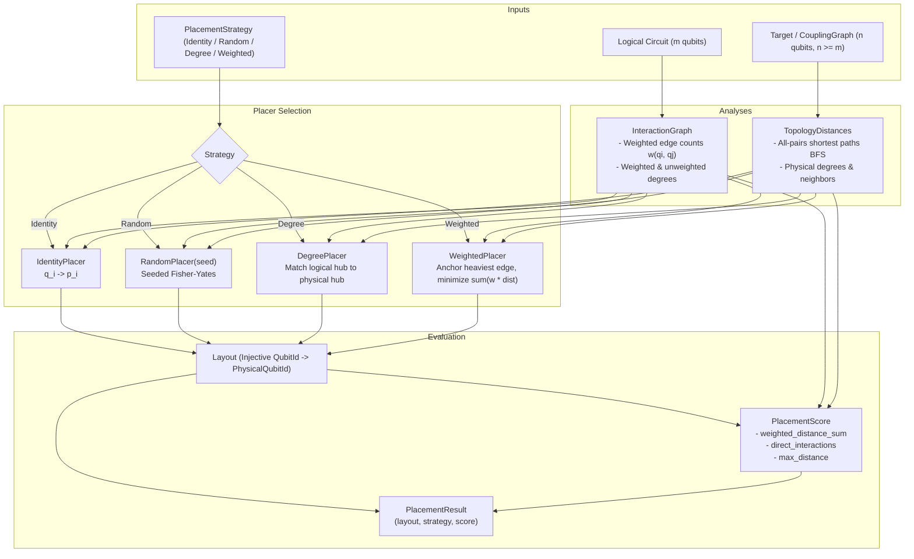

# Phase 46 Completion Report — Initial Placement Algorithms

## 1. Executive Summary

- **Phase Number**: Phase 46
- **Phase Title**: Initial placement algorithms
- **Milestone**: Milestone M5: Logical-to-Physical Mapping and Routing (`M5`)
- **Exit Gate**: Placement fixtures yield reproducible, valid mappings, or explicitly report impossible capacity (**PASSED**)
- **Baseline Git Checkpoint**: `c4e082f` (`test(phase-45): add multi-probe regression test for nontrivial global phase pi/3 under layout`)
- **Status**: Completed and fully verified with 100% test pass across all targets.

Phase 46 delivers the **Initial Placement Engine** for the Quantum Circuit Compiler (QCC). It provides deterministic algorithms to select a high-quality initial physical layout ($L_{\text{initial}}$) mapping logical program qubits to target physical sites prior to circuit routing. It extracts logical interaction frequencies, computes all-pairs shortest paths on the physical coupling graph, provides four distinct placement strategies, and quantifies layout quality through a deterministic multi-objective scoring metric.

Key architectural deliverables:
1. **Logical Interaction Graph ([`src/routing/placement/interaction_graph.rs`](file:///home/ronanki_jitendra/rust/QCC/src/routing/placement/interaction_graph.rs))**:
   - Implemented [`InteractionGraph`](file:///home/ronanki_jitendra/rust/QCC/src/routing/placement/interaction_graph.rs): extracts two-qubit interaction frequencies across circuit gates, storing canonical undirected pairs $(q_1 < q_2)$ in a deterministic `BTreeMap`.
   - Supports queries for edge weight, unweighted degree, weighted degree, interacting neighbors, and degree-ordered rankings.
2. **Topology Distance Metrics ([`src/routing/placement/distance.rs`](file:///home/ronanki_jitendra/rust/QCC/src/routing/placement/distance.rs))**:
   - Implemented [`TopologyDistances`](file:///home/ronanki_jitendra/rust/QCC/src/routing/placement/distance.rs): computes all-pairs shortest path distance matrices on the target's physical [`CouplingGraph`](file:///home/ronanki_jitendra/rust/QCC/src/target/connectivity.rs) via breadth-first search (BFS).
   - Provides physical degrees, neighbor lookups, graph diameter, and degree-ordered physical qubit rankings.
3. **Placement Strategies ([`src/routing/placement/trivial.rs`](file:///home/ronanki_jitendra/rust/QCC/src/routing/placement/trivial.rs), [`degree.rs`](file:///home/ronanki_jitendra/rust/QCC/src/routing/placement/degree.rs), [`weighted.rs`](file:///home/ronanki_jitendra/rust/QCC/src/routing/placement/weighted.rs))**:
   - **Identity** ([`IdentityPlacer`](file:///home/ronanki_jitendra/rust/QCC/src/routing/placement/trivial.rs)): Straightforward $q_i \to p_i$ baseline with capacity validation.
   - **Random** ([`RandomPlacer`](file:///home/ronanki_jitendra/rust/QCC/src/routing/placement/trivial.rs)): Deterministic seeded Fisher-Yates permutation; identical seeds guarantee identical layouts with zero unseeded randomness.
   - **Degree-Based** ([`DegreePlacer`](file:///home/ronanki_jitendra/rust/QCC/src/routing/placement/degree.rs)): Matches logical interaction hubs to high-degree physical topology hubs, then greedily places logical neighbors on available physical neighbors with highest connectivity.
   - **Interaction-Weighted** ([`WeightedPlacer`](file:///home/ronanki_jitendra/rust/QCC/src/routing/placement/weighted.rs)): Evaluates candidate physical anchor edges for the heaviest logical interaction edge, then iteratively places remaining logical qubits by maximizing affinity and minimizing total weighted physical distance $\sum w(q_i, q_j) \cdot \operatorname{dist}(p_i, p_j)$.
4. **Deterministic Placement Scoring ([`src/routing/placement/score.rs`](file:///home/ronanki_jitendra/rust/QCC/src/routing/placement/score.rs))**:
   - Implemented [`PlacementScore`](file:///home/ronanki_jitendra/rust/QCC/src/routing/placement/score.rs): computes weighted distance sum, unweighted distance sum, max distance, direct adjacent edge count, direct interaction fraction, and disconnected component penalties. Implements [`Ord`] for deterministic comparisons.
5. **Unified Placement API & Orchestration ([`src/routing/placement/mod.rs`](file:///home/ronanki_jitendra/rust/QCC/src/routing/placement/mod.rs))**:
   - [`place_circuit`](file:///home/ronanki_jitendra/rust/QCC/src/routing/placement/mod.rs#L30-L39): high-level entry point resolving physical coupling from [`Target`](file:///home/ronanki_jitendra/rust/QCC/src/target/model.rs).
   - [`place_circuit_with_coupling`](file:///home/ronanki_jitendra/rust/QCC/src/routing/placement/mod.rs#L42-L61): direct coupling graph placement.
   - [`place_best_of`](file:///home/ronanki_jitendra/rust/QCC/src/routing/placement/mod.rs#L64-L86): evaluates candidate strategies and returns the one with the minimal placement score.
6. **Topology Fixtures Extension ([`src/target/connectivity.rs`](file:///home/ronanki_jitendra/rust/QCC/src/target/connectivity.rs))**:
   - Added `CouplingGraph::ring(num_qubits, directionality)` and `CouplingGraph::star(num_qubits, hub, directionality)` constructors alongside existing `linear_chain` and `grid_2d`.

---

## 2. Key Architecture & Flow



---

## 3. Verification & Test Evidence

### 3.1 Test Suite Breakdown (`tests/routing/placement.rs`)

| Test Name | Focus | Result |
| :--- | :--- | :---: |
| `test_interaction_graph_construction_and_weights` | 2Q gate extraction, repeated edge weight counts, and degree rankings | **PASSED** |
| `test_topology_distances_line` | All-pairs shortest path BFS on 1D linear chain topology | **PASSED** |
| `test_topology_distances_ring` | Cyclic distances and diameter on 1D ring topology | **PASSED** |
| `test_topology_distances_grid` | Manhattan distances and interior physical degrees on 2D grid topology | **PASSED** |
| `test_topology_distances_star` | Hub and satellite distances and degrees on star topology | **PASSED** |
| `test_topology_distances_irregular` | T-shaped irregular coupling graph with varying degree vertices | **PASSED** |
| `test_identity_placement_valid` | Baseline $q_i \to p_i$ placement and ADR-0001 idle ancillae tracking | **PASSED** |
| `test_identity_placement_capacity_mismatch_fails` | Explicit failure when $m > n$ with `InsufficientCapacity` | **PASSED** |
| `test_random_seeded_placement_reproducibility` | Exact layout reproducibility across identical seeds; distinct seeds vary | **PASSED** |
| `test_degree_based_placement_on_star_topology` | Logical star hub correctly placed onto physical star hub | **PASSED** |
| `test_interaction_weighted_placement_optimizes_heavy_edges` | Heaviest interaction pair (100 CX) anchored at physical distance 1 | **PASSED** |
| `test_weighted_vs_identity_scoring_comparison` | Cross-interaction circuit: weighted score strictly outperforms identity | **PASSED** |
| `test_place_best_of_selection` | Multi-strategy evaluation selecting minimal score on chain target | **PASSED** |
| `test_placement_produces_injective_layout_with_adr0001_ancillae` | Injective forward/reverse lookups and idle physical ancillae validation | **PASSED** |
| `test_placement_circuit_with_only_single_qubit_gates` | Circuit with 0 two-qubit interactions handled cleanly with perfect score | **PASSED** |

### 3.2 Verification Commands Summary

```bash
# 1. Routing integration test target (including placement tests)
cargo test --test routing
# Output: 24 passed; 0 failed; 0 ignored (15 new placement tests + 9 layout tests)

# 2. Workspace unit tests
cargo test --lib
# Output: 106 passed; 0 failed; 0 ignored

# 3. Full test suite across all 35 test targets
PYTHONPATH=/tmp/py_packages cargo test
# Output: 1,113 passed; 0 failed; 0 ignored

# 4. Code formatting check
cargo fmt --check
# Output: Clean (0 diffs)

# 5. Clippy compiler lints check
cargo clippy --all-targets -- -D warnings
# Output: Clean (0 warnings, 0 errors)

# 6. Rustdoc generation check
cargo doc --no-deps
# Output: Clean (0 warnings)

# 7. Independent OpenQASM 3 Reference Parser (pinned v1.0.1)
PYTHONPATH=/tmp/py_packages cargo test test_independent -- --nocapture
# Output: 5 passed; 0 failed; 0 ignored

# 8. Milestone Executables
cargo run --example bell && cargo run --example qasm
# Output: Both executed successfully
```

---

## 4. Progress Ledger & Next Steps

- **Milestone M5 Progress**: Phase 46 is completed (3 / 10 phases complete in M5).
- **Total Project Progress**: 46 / 105 phases complete.
- **Next Phase**: **Phase 47: Baseline Shortest-Path Router** (executable 2Q nodes in DAG, target adjacency/orientation checks, bounded path-based SWAP insertion).
