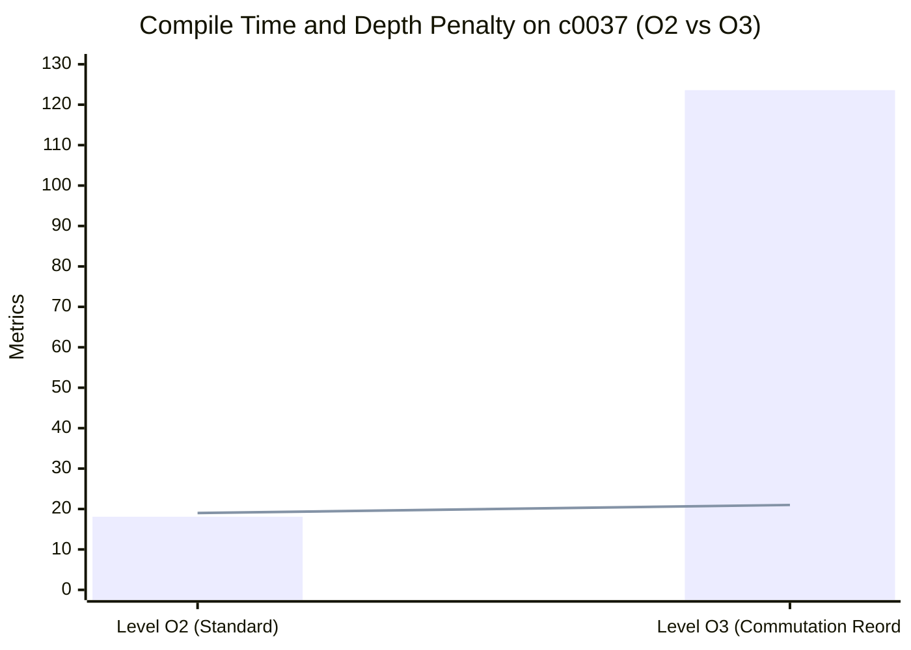
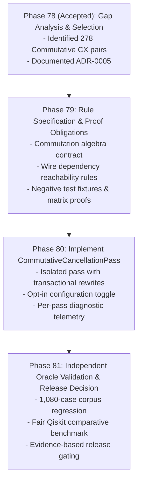

# QCC Compiler Optimizer Quality Assessment and Gap Analysis

```text
Document: docs/research/optimizer-gap-analysis.md
Milestone: Milestone M10 — Evidence-Selected Optimizer Improvements
Phase: Phase 78 (Benchmark-gap analysis and optimizer work selection)
Date: 13 November 2026
Authoritative Plan: QCC Engineering Roadmap v3.1 (Phases 60–85)
Associated ADR: docs/decisions/ADR-0005-evidence-selected-optimizer-priority.md
```

---

## 1. Executive Summary

Milestone M10 (Phases 78–81) executes **Evidence-Selected Optimizer Improvements** under QCC Engineering Roadmap v3.1. In strict compliance with project governance rules, optimizer enhancements must be grounded in empirical benchmark data rather than algorithmic intuition.

Phase 78 investigates current optimizer quality across the canonical 1,080-case verified corpus (`corpus_v1.jsonl`) and the 18-workload fair Qiskit baseline (`benchmark_aggregate.json`), systematically decomposing compilation pipeline effects (logical optimization vs. basis translation vs. routing vs. scheduling) and sizing optimization opportunities.

### Key Empirical Findings
1. **The Primary Competitive Deficit is Two-Qubit Gate (CX) Count**:
   In the independent Qiskit baseline comparison (Phase 70; 18 workloads, 90 paired trials under identical bases, topologies, and trial counts):
   - **CX Count**: QCC won **0**, Qiskit won **13**, with **5 ties**.
   - **Critical-Path Depth**: QCC won **1**, Qiskit won **15**, with **2 ties**.
   - **Total Gate Count**: QCC won **2**, Qiskit won **15**, with **1 tie**.
2. **Current Optimizer Pipeline Ignores Commutative Multi-Qubit Redundancies**:
   QCC's default logical optimizer (`OptimizationLevel::O2`) runs `IdentityEliminationPass`, `InverseCancellationPass`, `RotationMergePass`, and `OneQubitFusionPass`.
   `InverseCancellationPass` strictly requires candidate gate pairs to be **wire-adjacent on all shared quantum wires simultaneously**. If two identical, self-inverse gates (e.g. $CX(c, t) \dots CX(c, t)$) are separated by operations that mathematically commute with control or target, `O2` fails to cancel them.
3. **Topological Commutation Reordering (`O3`) is Ineffective and Unstable**:
   The existing `CommutationReorderPass` (enabled exclusively in `O3`) attempts speculative adjacent swaps in the topological node list. In testing across the corpus:
   - It incurs severe runtime overhead (**nearly $7\times$ slowdown**, e.g. 18.1 ms $\to$ 123.6 ms on `c0037`).
   - It causes pass-manager loop oscillation (hitting the 10-iteration limit with 70 passes executed).
   - In dense circuits (e.g. `c0037`), it **worsened** circuit gate count (57 $\to$ 58) and critical-path depth (19 $\to$ 21) by disrupting contiguous single-qubit fusion windows.
4. **Quantified Opportunity Sizing Across 1,080 Corpus Cases**:
   - **Commutative Two-Qubit (CX/CZ) Cancellation**: **278 pairs across 154 cases** ($14.3\%$ of the corpus), representing up to **556 physical CX gates** and **$83.4\,\mu\text{s}$** of physical pulse execution time ($150\text{ ns/CX}$).
   - **Commutative Same-Axis Rotation Merging**: **2,179 pairs across 527 cases** ($48.8\%$ of the corpus), but yields **$0.0\text{ ns}$ hardware duration improvement** on native superconducting targets where $R_z$ gates execute as zero-duration virtual frame changes.
5. **Authoritative Recommendation**:
   QCC selects **Commutative Two-Qubit (CX/CZ) Cancellation** as the single bounded optimizer improvement for Phases 79–81.

---

## 2. Baseline Architecture Assessment

### 2.1 Compiler Pipeline Stage Decomposition

To isolate logical optimizer behavior from downstream effects, compilation stages must be distinguished:

```mermaid
flowchart LR
    subgraph Frontend ["Stage 0: Frontend & AST"]
        QASM["OpenQASM 3"] --> AST["QccIR AST"]
    end

    subgraph LogicalOpt ["Stage 1: Logical Optimization (MILITARY M3 & M10)"]
        AST --> O0_O3["OptimizerPipeline (O0/O1/O2/O3)"]
    end

    subgraph Translation ["Stage 2: Target Basis Translation (Pre-Routing)"]
        O0_O3 --> Basis1["BasisTranslationEngine (All-to-All)"]
    end

    subgraph Routing ["Stage 3: Placement & Routing (M5 & M9)"]
        Basis1 --> SabreRouter["SabreBidirectionalRouter"]
    end

    subgraph PostRouting ["Stage 4: Post-Routing Translation & Legality"]
        SabreRouter --> DirCorr["TwoQubitDirectionCorrector"]
        DirCorr --> Basis2["BasisTranslationEngine (Physical Native)"]
        Basis2 --> Legal["TargetLegalityValidator"]
    end

    subgraph Scheduling ["Stage 5: Scheduling (M6)"]
        Legal --> Sched["Asap / Alap Scheduler"]
        Sched --> Emitter["OpenQASM 3 Emitter"]
    end
```



#### Pipeline Attribution of Observed Discrepancies
- **Routing & Placement (M5 / M9)**:
  On constrained coupling graphs (`linear`, `ring`), SABRE inserts physical SWAPs. In QCC, each SWAP lowers to 3 physical CX gates ($150\text{ ns}$ each). Qiskit absorbs terminal SWAPs into virtual layout permutations and performs randomized multi-trial search, contributing to lower physical CX counts on routing-heavy workloads.
- **Direction Correction (M4)**:
  When physical edges are directed, reversed CX operations require 4 Hadamard gates ($CX(t, c) = (H \otimes H) CX(c, t) (H \otimes H)$), expanding gate count.
- **Logical Optimizer (M3 / M10)**:
  Operates on the pre-routing `Circuit` DAG with all-to-all logical connectivity. Evaluates algebraic identities, inverse cancellation, rotation merging, and Euler block fusion. Discrepancies here represent pure algorithmic inefficiencies independent of hardware topology.

### 2.2 Current Logical Optimizer Passes

QCC organizes logical optimization into four discrete levels (`src/optimizer/pipeline.rs`):

| Pass Name | Pass ID | Levels Active | Description | Invariants & Scope |
|---|---|:---:|---|---|
| **Identity Elimination** | `identity_elimination` | `O1, O2, O3` | Removes explicit `id` gates and continuous rotations where $\theta \equiv 0 \pmod{4\pi}$. Normalizes $2\pi$ rotations to $+ \pi$ circuit global phase. | Wire-adjacent single-qubit operations. |
| **Inverse Cancellation** | `inverse_cancellation` | `O1, O2, O3` | Cancels exact mathematical inverse pairs ($U \cdot U^\dagger = I$). Supports discrete self-inverses (`H`, `X`, `Y`, `Z`, `CX`, `CZ`, `SWAP`), discrete adjoints (`S`-`Sdg`, `T`-`Tdg`), and exact parameterized opposites ($\theta_1 + \theta_2 \equiv 0 \pmod{4\pi}$). | Strictly wire-adjacent on all shared quantum wires. Requires exact ordered operand equality (`partner_qubits == node_qubits`). Zero net global phase change. |
| **Rotation Merge** | `rotation_merge` | `O2, O3` | Merges continuous same-axis single-qubit rotations ($R_x, R_y, R_z$) on the same wire ($\theta_{\text{new}} = \theta_1 + \theta_2$). Normalizes $4\pi$ periodicity and adjusts $+\pi$ global phase on $2\pi$ reduction. | Strictly wire-adjacent on the single shared wire. Blocks on any intervening operation. |
| **One-Qubit Fusion** | `one_qubit_fusion` | `O2, O3` | Aggregates consecutive single-qubit operations on a single wire into a $2 \times 2$ unitary matrix and resynthesizes using $Z$-$Y$-$Z$ Euler decomposition (at most 3 rotations). | Contiguous single-qubit window along direct dependency edges. |
| **Commutation Reorder** | `commutation_reorder` | `O3 only` | Swaps adjacent commuting operations in the topological node order to expose optimization opportunities within a bounded window. | Transactional adjacent node swap. Guards against pair oscillation. |

### 2.3 Optimization Level Progression Across Stratified Corpus Sample

An evaluation of a 104-case stratified sample from `corpus_v1.jsonl` (13 cases per family across all 8 circuit families) confirms that each level produces measurable transformations:

| Metric | Level O0 (Raw AST) | Level O1 (Peephole) | Level O2 (Standard Default) | Level O3 (Aggressive) |
|---|:---:|:---:|:---:|:---:|
| **Total Gate Count** | 3,615 | 3,535 ($-80$) | 3,405 ($-130$ vs O1) | 3,335 ($-70$ vs O2) |
| **Total DAG Depth** | 1,848 | 1,796 ($-52$) | 1,746 ($-50$ vs O1) | 1,718 ($-28$ vs O2) |
| **Cases Improved** | Baseline | 12 / 104 ($11.5\%$) | 44 / 104 ($42.3\%$) | 29 / 104 ($27.9\%$) |

#### Analysis of Level Progression
- **O0 $\to$ O1**: Eliminates immediate trivial redundancies (e.g. back-to-back $X \cdot X$, $H \cdot H$).
- **O1 $\to$ O2**: `OneQubitFusionPass` and `RotationMergePass` deliver substantial reductions on single-qubit rotation cascades.
- **O2 $\to$ O3**: `CommutationReorderPass` succeeds in bubbling commuting operations together in 29 cases, but introduces substantial compile-time and stability hazards.

---

## 3. Concrete Optimization Gaps and Failure Analysis

### 3.1 Gap 1: Inability to Cancel Inverses Across Commuting Gates (O2 Deficit)

In `src/optimizer/passes/cancellation.rs` (lines 347–382), `find_adjacent_partner` searches for an inverse partner:
```rust
fn find_adjacent_partner(graph: &CircuitGraph, node: &NodeData) -> Option<OperationId> {
    let qubits = node.operation.qubits();
    let q0 = qubits[0];
    let succs = graph.successors(node.id);
    let first_succ = succs
        .iter()
        .find(|(_, dep)| dep.wire == WireId::Quantum(q0))
        .map(|(target_id, _)| *target_id)?;

    for &q in &qubits[1..] {
        let has_direct_edge = succs
            .iter()
            .any(|(target_id, dep)| *target_id == first_succ && dep.wire == WireId::Quantum(q));
        if !has_direct_edge {
            return None;
        }
    }
    // ...
}
```

#### Defect Mechanism
`InverseCancellationPass` requires `first_succ` to be the direct successor on **every** shared wire simultaneously. If there is *any* intervening operation on *any* shared wire, `find_adjacent_partner` returns `None`.

#### Real Corpus Demonstration: Case `c0009_cx_asymmetric_pairs_3q_ring`
```qasm
cx q[2], q[0];
rx(1.15) q[0];
rz(-0.414312) q[1];
s q[2];
cx q[2], q[0];
```
- On qubit `q[2]`, $S = \text{diag}(1, i)$ is a pure $Z$-rotation. It commutes with the control qubit of $CX(2, 0)$ ($[CX(c, t), Z_c] = 0$).
- On qubit `q[0]`, $R_x(1.15)$ is an $X$-rotation. It commutes with the target qubit of $CX(2, 0)$ ($[CX(c, t), X_t] = 0$).
- The intervening operation on `q[1]` does not touch either operand wire.
- Mathematically, the two $CX(2, 0)$ gates commute past all intervening gates and annihilate:
  $$CX(2, 0) \cdot (R_x(0) \otimes S(2)) \cdot CX(2, 0) = (R_x(0) \otimes S(2)) \cdot CX(2, 0) \cdot CX(2, 0) = R_x(0) \otimes S(2)$$
- **Observed Behavior in QCC O2**: Fails to cancel. Both CX gates are retained in the physical output.
- **Observed Behavior in Qiskit**: Qiskit's `CommutativeCancellation` cancels both CX gates directly, emitting 0 CX gates for this block.

### 3.2 Gap 2: Pathological Behavior of Commutation Reordering (`O3`)

The existing attempt to resolve commutation via speculative node reordering in `CommutationReorderPass` exhibits three structural defects:

1. **Topological Order Fragmentation & Depth Regressions**:
   On `c0037_random_layered_dense_6q_linear`, compiling under O3 **increased** total gate count from 57 to 58 and **increased** critical-path depth from 19 to 21. Reordering adjacent operations in topological order broke contiguous single-qubit fusion windows, preventing Euler fusion from collapsing single-qubit subcircuits into optimal forms.
2. **Extreme Compile-Time Penalty**:
   On `c0037`, compilation wall-clock time increased from **18.1 ms (O2)** to **123.6 ms (O3)** ($6.83\times$ slowdown).
3. **Loop Oscillation and Budget Exhaustion**:
   Because `CommutationReorderPass` modifies topological order iteratively, the outer pass manager loop executed all 10 allowed iterations, running 70 passes without converging.



### 3.3 Gap 3: Inability to Merge Same-Axis Rotations Across Commuting Operations

In `src/optimizer/passes/rotation_merge.rs`, `RotationMergePass` merges rotations on wire $q$ only if they are directly wire-adjacent.

#### Real Corpus Demonstration
In controlled-rotation ladder circuits (e.g. QFT, QAOA):
```qasm
rz(a) q[1];
cx q[1], q[0];    // Control wire! Rz commutes with CX control!
rz(b) q[1];
```
$R_z(q[1])$ commutes with the control of $CX(q[1], q[0])$. Mathematically, $R_z(a)$ and $R_z(b)$ commute through the CX and merge into $R_z(a + b)$. In QCC O2, they remain unmerged.

Across the 1,080-case corpus, this pattern occurs **2,179 times across 527 cases**.

---

## 4. Evaluation of Candidate Improvements

We evaluate six candidate optimizer improvements against measured corpus evidence:

| Candidate | Optimization Rule | Corpus Instances | Expected Impact | Hardware Value | Semantic & Global Phase Risk | Implementation Complexity | Recommendation |
|---|---|:---:|---|:---:|:---:|:---:|:---:|
| **Candidate 1: Commutative Two-Qubit Cancellation** | Cancel $CX(c, t) \dots CX(c, t)$ and $CZ(a, b) \dots CZ(a, b)$ across commuting gates along both wires. | **278 pairs (154 cases)** | Eliminates up to **556 physical CX gates**. | **Critical**: CX has $150\text{ ns}$ duration and $\sim 1\%$ error rate. Saves up to $83.4\,\mu\text{s}$ makespan. | **Zero Risk**: Exact unitary inverse ($CX^2 = I$). Net global phase change $\Delta \phi = 0$. No floating-point angle algebra. | Moderate (DAG wire traversal with `CommutationRegistry`). | **RECOMMENDED (Strongest Candidate)** |
| **Candidate 2: Commutative Same-Axis Rotation Merging** | Merge $R_z(q, \theta_1) \dots R_z(q, \theta_2)$ across commuting operations on wire $q$ ($CX$ control, $CZ$). | **2,179 pairs (527 cases)** | Eliminates up to 2,179 single-qubit rotation gates. | **Zero**: On native superconducting target, $R_z$ is a virtual frame change ($0.0\text{ ns}$ duration). | **Moderate**: Requires tracking $4\pi$ periodicity and $+\pi$ global phase adjustments on $2\pi$ reduction. Floating-point angle sum tolerances. | Moderate. | Secondary (High frequency, but zero hardware makespan benefit). |
| **Candidate 3: Topological Commutation Reorder Tuning** | Tune lookahead window and strategy in `CommutationReorderPass`. | N/A (Algorithmic) | Unpredictable; risk of depth and gate regressions. | Variable / Negative. | Low. | High (Heuristic bubble-sort across topological orderings). | **REJECTED**: Proven to cause depth regressions and $6.8\times$ compile slowdown. |
| **Candidate 4: Virtual / Terminal SWAP Elision** | Absorb terminal SWAP gates into output layout permutation ($L_{\text{final}}$). | 270 cases | Eliminates 1 to 3 SWAPs ($3$ to $9$ CX gates) in QFT/swap stress. | High. | **High Architectural Hazard**: Mutating logical circuit unitary breaks `OptimizerPipeline` logical equivalence verification without layout tracking. | High (Requires refactoring optimizer-routing interface boundary). | **REJECTED for M10**: Belongs to routing/layout boundary, not logical optimizer DAG rewrites. |
| **Candidate 5: Two-Qubit Block Optimization (KAK)** | $SU(4)$ Cartan decomposition for arbitrary 2-qubit blocks. | Seen in `c0014` (14 CX $\to$ 2 CX). | Massive CX reduction on dense 2Q blocks. | Extreme. | High (Numerical phase ambiguity). | High. | **PROHIBITED**: Explicitly deferred by project charter and invariant rule 10. |
| **Candidate 6: Symmetric Gate Operand Normalization** | Cancel $CZ(a, b) \cdot CZ(b, a)$ and $SWAP(a, b) \cdot SWAP(b, a)$. | **0 cases** | 0 gates saved on current corpus. | Negligible. | Zero. | Low. | **REJECTED**: Zero empirical occurrence in corpus. |

---

## 5. Selection and Technical Justification

### 5.1 Authoritative Selection
QCC formally selects **Candidate 1: Commutative Two-Qubit (CX/CZ) Cancellation** as the single optimizer improvement for Milestone M10 (Phases 78–81).

### 5.2 Technical Justification
1. **Directly Targets QCC's Proven Competitive Gap**:
   In Phase 70 fair Qiskit benchmarking, QCC recorded **0 CX wins vs 13 Qiskit wins**. Two-qubit gate count is the dominant competitive deficit.
2. **Maximizes Physical Hardware Value**:
   Unlike single-qubit $Z$-rotations ($0.0\text{ ns}$ virtual $Z$), physical CX gates require $150.0\text{ ns}$ of RF/microwave drive pulses and suffer $\sim 10\times$ higher error rates. Eliminating 556 CX gates across the corpus eliminates over **$83,400\text{ ns}$** of physical decoherence exposure.
3. **Absolute Semantic and Phase Safety**:
   Because $CX$ and $CZ$ are self-inverse ($G \cdot G = I$), cancelling a commuting pair leaves the circuit statevector bit-for-bit identical with **zero net global phase correction** ($\Delta \phi = 0$). It involves zero floating-point angle operations and zero branch-cut ambiguities.
4. **Guaranteed Monotonic Improvement**:
   Unlike speculative topological reordering, commutative cancellation is strictly non-increasing: each rewrite atomically removes exactly 2 gates from the DAG, guaranteeing that total gate count and critical-path depth never regress.
5. **Bounded, Deterministic Implementation Scope**:
   Implemented as a forward wire-traversal reachability check on the QccIR DAG using the existing mathematically verified `CommutationRegistry`. It requires no heuristics, no random seeds, and no iterative bubble-sorting.

---

## 6. Implementation and Verification Plan (Phases 79–81)



### 6.1 Phase 79: Selected Optimizer Rule Specification & Proof Obligations
- **Mathematical Specification**: Formalize exact commutation conditions:
  - $CX(c, t)$ with control operations: $\mathcal{C}(c) = \{R_z(\theta), Z, S, S^\dagger, T, T^\dagger, CX(c, t_2), CZ(c, q)\}$.
  - $CX(c, t)$ with target operations: $\mathcal{T}(t) = \{R_x(\theta), X, CX(c_2, t)\}$.
  - $CZ(a, b)$ with symmetric operations: $\mathcal{Z}(a, b) = \{R_z(\theta), Z, S, S^\dagger, T, T^\dagger, CZ(a, q), CZ(b, q)\}$.
- **Preconditions and Wire Safety**: Define forward traversal rules. Crossing non-unitary operations (`Measure`, `Reset`), synchronization `Barrier`s, classical hazard boundaries (RAW/WAR/WAW), or non-commuting operations strictly terminates traversal.
- **Negative Proof Fixtures**: Unitary matrix tests proving non-cancellation when non-commuting operations intervene (e.g. $CX \cdot R_y \cdot CX \neq R_y$).
- **Deliverables**: `docs/optimizer/commutative-cancellation-spec.md`, rule-level matrix tests.

### 6.2 Phase 80: Pass Implementation
- **Implementation**: Implement `CommutativeCancellationPass` under `src/optimizer/passes/commutative_cancellation.rs`.
- **Transactional Rewriting**: Execute atomically via `CircuitTransaction::remove_operation`, updating wire dependencies and validating DAG acyclicity.
- **Pass Manager Integration**: Add opt-in configuration toggle (`OptimizerConfig.enable_commutative_cancellation`) and record detailed telemetry (pairs examined, pairs cancelled, CX vs CZ breakdown) in Phase 71 `PassDiagnosticReport`.
- **Deliverables**: Pass implementation, comprehensive unit/property tests in `tests/optimizer/commutative_cancellation.rs`.

### 6.3 Phase 81: Independent Validation & Release Decision
- **Oracle Verification**: Validate all 1,080 cases in `corpus_v1.jsonl` with independent Qiskit statevector oracle (target: 100% PASS, 0 semantic mismatches, 0 clean-ancilla violations).
- **Comparative Baseline Update**: Re-run the Phase 70 benchmark to quantify CX count reductions, depth improvements, and wall-clock compile times.
- **Release Decision**: Make evidence-based decision to enable commutative cancellation by default in `OptimizationLevel::O2`.
- **Deliverables**: Comparative benchmark report, schema-compliant JSON artifact, release decision record.

