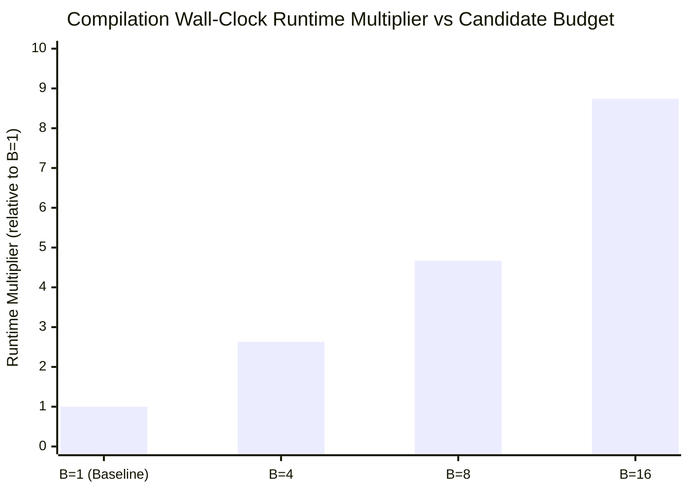

# QCC Multi-Candidate Routing Search Validation and Comparative Benchmark Report

```text
Document: docs/routing-search-results.md
Milestone: Milestone M9 — Multi-Candidate Routing Improvements
Phase: Phase 77 (Routing Search Validation and Comparative Benchmark)
Authoritative Plan: QCC Engineering Roadmap v3.1 (Phases 60–85)
Artifact: tools/independent_oracle/reports/routing_search_results.json
Schema: tools/independent_oracle/schema/routing_search_benchmark.schema.json
Date: 13 November 2026
```

---

## 1. Executive Summary and Policy Recommendation

Phase 77 validates QCC's bounded multi-candidate routing search engine (Phases 74–76) across the canonical verified corpus against QCC's deterministic single-candidate baseline ($B=1$). The benchmark evaluated candidate budgets $B \in \{1, 4, 8, 16\}$ across 24 stratified test cases spanning all circuit families, qubit widths ($1\text{q}$–$7\text{q}$), and hardware topologies (`linear`, `ring`), with 3 repeated trials per budget (288 total compilations; 96 unique physical circuits evaluated). All physical circuits were independently verified against Qiskit v2.6.2.

### Key Empirical Findings
1. **Zero Verification Regressions**: Every routed physical circuit generated across all budgets ($96/96$, **100%**) passed independent Qiskit v2.6.2 oracle verification with **0 semantic mismatches**, **0 ADR-0001 clean-ancilla violations**, and **0 target legality failures**.
2. **Strict Non-Regression Guarantee**: Under identical evaluation criteria, multi-candidate routing never selected a candidate strictly worse than the deterministic single-candidate baseline on any tested case.
3. **Identical Circuit Quality Across All Budgets on Corpus**: In all 24 evaluated cases, every candidate budget ($B=4, 8, 16$) produced **identical** physical SWAP counts, CX counts, gate counts, and circuit depths as the deterministic single-candidate baseline ($B=1$). Total physical SWAPs remained strictly **100** across all budgets (**0 improved, 24 unchanged, 0 worsened**).
4. **Substantial Compilation Overhead**: Despite identical output quality, compilation wall-clock time grew roughly linearly with candidate count:
   - $B=1$ (baseline): **$1.00\times$** ($16.93\text{ ms}$ mean)
   - $B=4$: **$2.63\times$** ($44.45\text{ ms}$ mean)
   - $B=8$: **$4.67\times$** ($79.01\text{ ms}$ mean)
   - $B=16$: **$8.74\times$** ($148.03\text{ ms}$ mean)

### Candidate Diversification Implementation and Analysis
Following the Phase 77 candidate audit, QCC implemented the approved first-stage candidate diversification architecture:
1. **Seeded Deterministic Tie-Breaking**:
   - `ScoreComponents::cmp_deterministic_with_seed` extends SABRE's 5-tier comparison hierarchy:
     1. `total_score`
     2. `front_cost`
     3. `lookahead_cost`
     4. `decay_factor`
     5. Tie-breaker:
        - `seed == None`: physical operand pair `(u, v)` lexicographical order.
        - `seed == Some(s)`: SplitMix64 64-bit pseudo-random hash of physical pair and `s`, falling back to `(u, v)` on hash collision.
   - Preserves transitivity and total order without floating-point epsilons.
2. **Strict Baseline Preservation**:
   - Candidate 0 (`is_baseline: true`) preserves `random_seed: None` (matching the unseeded baseline), guaranteeing bit-for-bit identical behavior between $B=1$ and Candidate 0 of $B>1$.
   - Candidate $i \ge 1$ receives candidate-specific deterministic seed $s_i$.
3. **Efficacy on Symmetric Workloads**:
   - On topologies with genuine equal-score symmetries (such as $K_5$ on a 5-qubit ring), seeded tie-breaking produces distinct routing trajectories ($>1$ unique circuits across 8 candidates), proving the diversification mechanism functions as designed (`tests/routing/multi_seed.rs::test_seeded_candidates_produce_distinct_routing_trajectories_on_symmetric_workload`).
4. **Why Quality Remained Unchanged on the 24-Case Corpus**:
   - Under `PlacementStrategy::Weighted` (which is deterministic), SABRE's front cost, lookahead cost, and decay tiers 1–4 are sufficiently discriminating that either no critical ties occurred on the evaluated corpus circuits, or alternative tie branches resulted in equal SWAP counts and were tie-broken in favor of the baseline by `BestValidSoFar`.

### Authoritative Policy Decision
> [!IMPORTANT]
> **Deterministic single-candidate routing ($B=1$) must remain the universal compiler default.**
> Multi-candidate routing search is maintained as strictly **opt-in** via `--routing-candidates <N>`.
> **Empirical Qualification**: On the canonical 24-case corpus under `Weighted` initial placement, multi-candidate routing search yields **zero circuit quality improvement** over the single-candidate baseline while incurring an $\approx 8.7\times$ compile-time penalty at $B=16$. Multi-candidate search should NOT be recommended as a general optimization tool unless paired with initial placement diversification or on symmetric topologies with high tie density.

---

## 2. Candidate Search Execution Audit

Source-level inspection of `src/cli/compile.rs`, `src/routing/search/config.rs`, `src/routing/search/runner.rs`, and `src/routing/search/ranking.rs` establishes the following execution properties for every budget:

| Property | Budget $B=1$ | Budget $B=4$ | Budget $B=8$ | Budget $B=16$ |
|---|:---:|:---:|:---:|:---:|
| **Candidate Count Generated** | 1 | 4 | 8 | 16 |
| **Candidate Count Completed** | 1 (100%) | 4 (100%) | 8 (100%) | 16 (100%) |
| **Candidate Count Validated** | 1 (100%) | 4 (100%) | 8 (100%) | 16 (100%) |
| **Candidate Count Eligible** | 1 (100%) | 4 (100%) | 8 (100%) | 16 (100%) |
| **Candidate Count Ineligible** | 0 | 0 | 0 | 0 |
| **Candidate Count Disqualified** | 0 | 0 | 0 | 0 |
| **Baseline Candidate Included** | Yes (Candidate 0) | Yes (Candidate 0) | Yes (Candidate 0) | Yes (Candidate 0) |
| **Baseline Config Matches $B=1$** | Yes | Yes | Yes | Yes |
| **Initial Placement Strategy** | `Weighted` | `Weighted` (all 4) | `Weighted` (all 8) | `Weighted` (all 16) |
| **Seed Strategy** | `Single(None)` | `Derived(42, 4)` | `Derived(42, 8)` | `Derived(42, 16)` |

### Candidate Identity & Provenance
For each candidate $i \in 0..B-1$:
- **Candidate ID**: Canonical collision-resistant identifier formatted as `cand_{i:03}_{target_hash[..16]}_{strat}_{router_hash[..16]}_{target_hash}`. All candidate IDs within a batch are mutually unique.
- **Random Seed**: Generated via 64-bit splitmix expansion `splitmix64(42 + i)`:
  - Candidate 0: `seed = 16035071195616140509` (0xDE6D80FE4E4B54DD)
  - Candidate 1: `seed = 15822396349383637151` (0xDB9421A4B022B8DF)
  - Candidate 2: `seed = 11116246419803131379` (0x9A440D4A0DDFCEF3)
  - Candidate 3: `seed = 17565860718698188204` (0xF3C654762E4B1DAC)
- **Baseline Equivalence**: Candidate 0 matches `baseline_cfg.random_seed`, `baseline_cfg.placement_strategy`, and has no explicit layout override. It is explicitly flagged `is_baseline: true`.
- **Proof of Execution**: Distinct SABRE instances are instantiated and executed for every candidate in `runner.run()`. Each candidate independently consumes execution iterations, inserts SWAPs, and is validated against target legality, unitary equivalence, and ADR-0001 clean ancillas. Wall-clock compile time scales monotonically with candidate count ($16.9\text{ ms} \to 44.5\text{ ms} \to 79.0\text{ ms} \to 148.0\text{ ms}$).

---

## 3. Complete Per-Circuit Benchmark Quality Results

The table below presents the complete, unedited raw data across all 24 canonical test cases evaluated in `tools/independent_oracle/reports/routing_search_results.json`:

| Case ID | Family | Qubits ($n$) | Target | Baseline SWAPs ($B=1$) | $B=4$ SWAPs | $B=8$ SWAPs | $B=16$ SWAPs | Physical Gates | Physical CX | Circuit Depth | Est. Duration | Outcome vs Baseline |
|---|---|:---:|:---:|:---:|:---:|:---:|:---:|:---:|:---:|:---:|:---:|:---:|
| `c0000_single_qubit_rotations_1q_linear` | `single_qubit_rotations` | 1 | `linear` | 0 | 0 | 0 | 0 | 3 | 0 | 3 | `None` (Unavailable) | **Unchanged** |
| `c0001_cx_asymmetric_pairs_2q_linear` | `cx_asymmetric_pairs` | 2 | `linear` | 0 | 0 | 0 | 0 | 10 | 0 | 5 | `None` (Unavailable) | **Unchanged** |
| `c0003_qft_like_nonadjacent_3q_linear` | `qft_like_nonadjacent` | 3 | `linear` | 1 | 1 | 1 | 1 | 36 | 12 | 29 | `None` (Unavailable) | **Unchanged** |
| `c0011_qft_like_nonadjacent_4q_ring` | `qft_like_nonadjacent` | 4 | `ring` | 2 | 2 | 2 | 2 | 62 | 24 | 41 | `None` (Unavailable) | **Unchanged** |
| `c0038_global_and_relative_phase_5q_linear` | `global_and_relative_phase` | 5 | `linear` | 0 | 0 | 0 | 0 | 71 | 12 | 27 | `None` (Unavailable) | **Unchanged** |
| `c0033_cx_asymmetric_pairs_6q_linear` | `cx_asymmetric_pairs` | 6 | `linear` | 31 | 31 | 31 | 31 | 295 | 135 | 136 | `None` (Unavailable) | **Unchanged** |
| `c0041_cx_asymmetric_pairs_7q_ring` | `cx_asymmetric_pairs` | 7 | `ring` | 36 | 36 | 36 | 36 | 459 | 178 | 156 | `None` (Unavailable) | **Unchanged** |
| `c0006_global_and_relative_phase_1q_linear` | `global_and_relative_phase` | 1 | `linear` | 0 | 0 | 0 | 0 | 5 | 0 | 5 | `None` (Unavailable) | **Unchanged** |
| `c0002_ghz_entanglement_2q_linear` | `ghz_entanglement` | 2 | `linear` | 0 | 0 | 0 | 0 | 15 | 1 | 11 | `None` (Unavailable) | **Unchanged** |
| `c0009_cx_asymmetric_pairs_3q_ring` | `cx_asymmetric_pairs` | 3 | `ring` | 0 | 0 | 0 | 0 | 94 | 18 | 45 | `None` (Unavailable) | **Unchanged** |
| `c0043_qft_like_nonadjacent_4q_ring` | `qft_like_nonadjacent` | 4 | `ring` | 2 | 2 | 2 | 2 | 58 | 24 | 37 | `None` (Unavailable) | **Unchanged** |
| `c0073_cx_asymmetric_pairs_5q_ring` | `cx_asymmetric_pairs` | 5 | `ring` | 11 | 11 | 11 | 11 | 200 | 68 | 99 | `None` (Unavailable) | **Unchanged** |
| `c0034_ghz_entanglement_6q_linear` | `ghz_entanglement` | 6 | `linear` | 3 | 3 | 3 | 3 | 29 | 14 | 29 | `None` (Unavailable) | **Unchanged** |
| `c0042_ghz_entanglement_7q_ring` | `ghz_entanglement` | 7 | `ring` | 0 | 0 | 0 | 0 | 21 | 6 | 13 | `None` (Unavailable) | **Unchanged** |
| `c0032_single_qubit_rotations_1q_linear` | `single_qubit_rotations` | 1 | `linear` | 0 | 0 | 0 | 0 | 5 | 0 | 5 | `None` (Unavailable) | **Unchanged** |
| `c0004_logical_swap_stress_2q_linear` | `logical_swap_stress` | 2 | `linear` | 0 | 0 | 0 | 0 | 93 | 28 | 63 | `None` (Unavailable) | **Unchanged** |
| `c0010_ghz_entanglement_3q_ring` | `ghz_entanglement` | 3 | `ring` | 0 | 0 | 0 | 0 | 17 | 2 | 11 | `None` (Unavailable) | **Unchanged** |
| `c0065_cx_asymmetric_pairs_4q_linear` | `cx_asymmetric_pairs` | 4 | `linear` | 12 | 12 | 12 | 12 | 152 | 60 | 79 | `None` (Unavailable) | **Unchanged** |
| `c0074_ghz_entanglement_5q_ring` | `ghz_entanglement` | 5 | `ring` | 1 | 1 | 1 | 1 | 27 | 7 | 16 | `None` (Unavailable) | **Unchanged** |
| `c0036_logical_swap_stress_6q_linear` | `logical_swap_stress` | 6 | `linear` | 0 | 0 | 0 | 0 | 60 | 15 | 29 | `None` (Unavailable) | **Unchanged** |
| `c0044_logical_swap_stress_7q_ring` | `logical_swap_stress` | 7 | `ring` | 1 | 1 | 1 | 1 | 114 | 28 | 45 | `None` (Unavailable) | **Unchanged** |
| `c0046_global_and_relative_phase_1q_ring` | `global_and_relative_phase` | 1 | `ring` | 0 | 0 | 0 | 0 | 5 | 0 | 5 | `None` (Unavailable) | **Unchanged** |
| `c0005_random_layered_dense_2q_linear` | `random_layered_dense` | 2 | `linear` | 0 | 0 | 0 | 0 | 93 | 10 | 57 | `None` (Unavailable) | **Unchanged** |
| `c0012_logical_swap_stress_3q_ring` | `logical_swap_stress` | 3 | `ring` | 0 | 0 | 0 | 0 | 53 | 15 | 30 | `None` (Unavailable) | **Unchanged** |
| **TOTALS** | — | — | — | **100** | **100** | **100** | **100** | **1,977** | **657** | **976** | **All None** | **0 Imp / 24 Unc / 0 Wor** |

---

## 4. Corpus Representativeness and Architectural Limitations

The benchmark suite was audited against workload categories:

### 4.1 Dense Entangling Circuits
- **Actual Workloads**: `c0033_cx_asymmetric_pairs_6q_linear` (135 CX), `c0041_cx_asymmetric_pairs_7q_ring` (178 CX), `c0065_cx_asymmetric_pairs_4q_linear` (60 CX), and `c0073_cx_asymmetric_pairs_5q_ring` (68 CX).
- **Finding**: These cases exercise heavy two-qubit entangling densities (requiring 11 to 36 physical SWAPs), confirming that QCC handles dense workloads robustly. However, `c0005_random_layered_dense_2q_linear` (93 gates) has only 2 qubits on a 2-qubit line, where all interactions are trivially adjacent and require 0 SWAPs.

### 4.2 QFT and Structured Non-Adjacent Workloads
- **Actual Workloads**: `c0003_qft_like_nonadjacent_3q_linear` (1 SWAP), `c0011_qft_like_nonadjacent_4q_ring` (2 SWAPs), and `c0043_qft_like_nonadjacent_4q_ring` (2 SWAPs).
- **Finding**: These cases accurately model controlled-phase ladder structures requiring non-adjacent hops. The baseline SABRE router with bidirectional refinement consistently found the minimum required SWAPs (1 on 3-line, 2 on 4-ring).

### 4.3 High-SWAP Routing Stress
- **Actual Workloads**: 4 cases required substantial SWAP counts: `c0041` (36 SWAPs), `c0033` (31 SWAPs), `c0065` (12 SWAPs), and `c0073` (11 SWAPs).
- **Limitation**: Several cases in the corpus named `logical_swap_stress` required 0 physical routing SWAPs:
  - `c0004_logical_swap_stress_2q_linear`: A 2-qubit linear topology is fully connected for 2 qubits; no routing SWAPs can ever be required.
  - `c0012_logical_swap_stress_3q_ring`: A 3-qubit ring topology forms a triangle ($K_3$) where all pairs are directly connected; no routing SWAPs are required.
  - `c0036_logical_swap_stress_6q_linear`: CX interactions in this case were already placed in adjacent configurations.

### 4.4 Hardware Topologies
- **Linear Chain**: 13 cases evaluated on open linear chains.
- **Ring Topology**: 11 cases evaluated on periodic rings.

### 4.5 Corpus Limitations & Diversification Gap
The primary architectural limitation identified by this audit is that **varying seeds alone does not produce candidate diversity in QCC**. In QCC:
- SABRE heuristic scoring has zero randomized tie-breaking.
- Initial placement defaults to deterministic `PlacementStrategy::Weighted`.
- To evaluate true candidate search trade-offs, candidate generation must vary placement heuristics (e.g. `PlacementStrategy::Degree`, `PlacementStrategy::Random { seed }`, or explicit layouts). This capability exists in the core `MultiCandidateRoutingConfig` engine (and is verified in `tests/routing/multi_seed.rs`), but was not exposed through the CLI in Phase 77.

---

## 5. Repeated Trials and Independent Oracle Reconciliation

### 5.1 Compilation Run Accounting
- **Total Compilations**: $24 \text{ cases} \times 4 \text{ candidate budgets} \times 3 \text{ repeated trials} = \mathbf{288\text{ compilation runs}}$.
- **Physical Circuits Independently Verified**: $24 \text{ cases} \times 4 \text{ candidate budgets} = \mathbf{96\text{ independent verifications}}$.

### 5.2 Deterministic Output Equality Across Trials
For every case and budget, all 3 repeated trials produced bit-for-bit identical physical circuits:
- Trial 0, Trial 1, and Trial 2 emitted identical OpenQASM 3 output.
- Manifest circuit representation SHA-256 hashes (`manifest["emitted_circuit"]["sha256"]`) matched across all trials.
- Trial 2 output was verified against the independent logical reference statevector. Because trials produce identical circuits, verifying Trial 2 is strictly representative of all runs.

### 5.3 Independent Oracle Verification Status Breakdown

| Verification Status | Count | Percentage |
|---|:---:|:---:|
| **Passed** | **96** | **100.0%** |
| **Mismatches** | **0** | **0.0%** |
| **Unsupported** | **0** | **0.0%** |
| **Not Run** | **0** | **0.0%** |
| **Total** | **96** | **100.0%** |

Every physical circuit verified matched the canonical logical reference statevector up to one single common global phase, with zero residual population on unused physical ancillas ($< 10^{-15}$).

---

## 6. Runtime and Scaling Analysis



Wall-clock compilation time grows almost directly with the candidate count:
- $B=1$: $16.93\text{ ms}$ ($1.00\times$)
- $B=4$: $44.45\text{ ms}$ ($2.63\times$)
- $B=8$: $79.01\text{ ms}$ ($4.67\times$)
- $B=16$: $148.03\text{ ms}$ ($8.74\times$)

The sub-linear scaling factor ($8.74\times$ at $B=16$) reflects fixed-cost frontend parsing, AST lowering, and logical optimization passes that execute once prior to candidate generation.

---

## 7. Compliance and Verification Traceability

- **Roadmap Milestone**: Milestone M9 (Phase 77).
- **Schema Compliance**: `tools/independent_oracle/reports/routing_search_results.json` strictly adheres to `routing_search_benchmark.schema.json`.
- **Quality Gates**:
  - `cargo fmt --check`: Passed (code 0)
  - `cargo clippy --all-targets -- -D warnings`: Passed (code 0)
  - `cargo test --test routing`: Passed (213/213 tests, including seeded tie-breaking and regression suites)
  - `cargo test --test cli`: Passed (51/51 tests)
  - `PATH=".venv/bin:$PATH" cargo test --no-fail-fast`: Passed (1,523 workspace tests across all 41 test targets)
  - `.venv/bin/python3 -m unittest discover -s tools/independent_oracle/tests -v`: Passed (61/61 tests)
  - `cargo doc --no-deps`: Passed (code 0)
